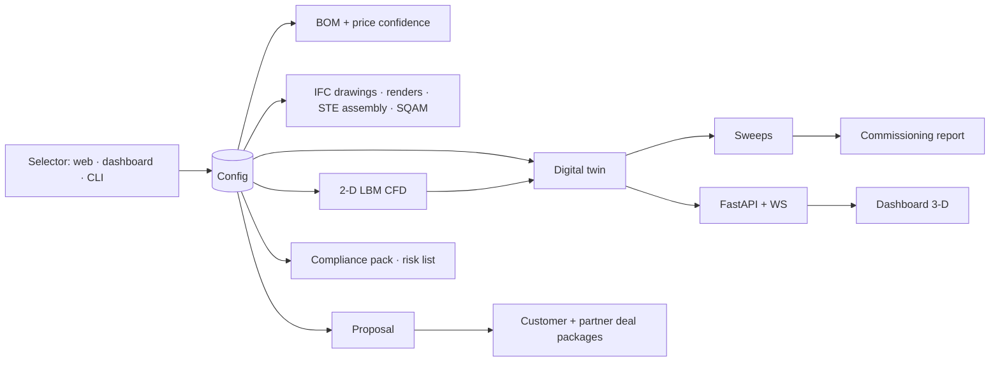

<p align="center"></p>

# BEN Engine — modular data centers you can run before they exist

**For** small and mid-size businesses, integrators and public-sector sites that want AI and IT on their own pad.
**The problem:** cloud bills that scale with success, colocation priced for hyperscalers, server closets nobody commissioned.
**The outcome:** a family of modular data centers (BEN Micro 2–5 kW cabinet to BEN 40 500 kW liquid-cooled container) built from off-the-shelf enclosures, with Schreiber AI's controls layer, digital twin, commissioning script and a complete, generated deal package. Every drawing, part, price, alarm threshold and proposal comes from one configuration model.


<sub>Static poster: [docs/media/demo-poster.png](docs/media/demo-poster.png). Real capture of the dashboard in simulation mode.</sub>

## What is here, and how verified it is

| Capability | Where | Status |
| --- | --- | --- |
| Configuration model: tiers, profiles, climates, sizing, validation (rows that do not fit are rejected) | `software/ben_engine/config.py`, `spec/` | verified (tests, 4 tiers × 8 profiles × climates) |
| Digital twin: thermal + power chain, 7 faults, ASHRAE-class alarms | `software/ben_engine/twin.py` | verified in simulation |
| 2-D thermal lattice-Boltzmann CFD per tier, recirculation profile into the twin | `software/ben_engine/cfd.py` | verified (runs, converges); relative tool only |
| Calibration (GUM budgets, tares, placement effects) and analysis (parameter fit, 95 % prediction intervals, ride-through) | `calibration.py`, `analysis.py` | verified on synthetic data |
| Automated sweeps with pass/fail and CSV | `sweeps.py` | verified (6/6 pass on BEN 20) |
| Commissioning script, FAT/SAT, signed report with SHA-256 | `commissioning.py` | verified in simulation (10/10 steps) |
| Dashboard: 3-D twin, walkthrough, guided tour, sweeps, fault injection, I/O test, calibration, CFD, export, **proposal** | `dashboard/`, `api.py` | verified (26 API tests, Playwright e2e with screenshots) |
| Proposal generator: selector → 16-section customer proposal, md/html/json, contract pre-fill | `proposal.py`, `docs/proposals/` | verified (16 tests; rendered and inspected) |
| Deal package assembler: customer package + partner package as zips | `package.py` | verified (tests; sample built) |
| Firmware: BEN Node core (calibration, telemetry, commands, ring buffer, failsafe) | `firmware/ben-node` | verified on host (37 unit tests); **ESP32 cross-build unverified** |
| Gateway package (Pi 5: broker, services, firewall, backups) | `firmware/ben-gateway` | implemented, unverified on hardware |
| IFC drawing set (7 sheets × 4 tiers) with CTQ/CTP tables, interference checks | `design/drawings/` | verified (generated, inspected) |
| Concept assembly renders and ASD-STE100 assembly instructions, QC forms, CTQ cards | `design/renders/`, `design/assembly/` | verified (generated; STE rules checked by script) |
| Supplier Quality Assurance Manual generated from the CTQ register | `docs/SQAM.md` | verified (generated) |
| Bill of materials with price confidence (confirmed / list / estimate) and 16 queued RFQ emails | `purchasing/`, `docs/BOM.md` | verified (21 tests); prices are listings, not quotes |
| Compliance matrix, risk register, process flow (third-party manufacturing), site requirements, turnover, maintenance, build & wiring, test guide, cybersecurity | `docs/` | written; edition years checked where possible |
| Two-sided paperwork: MSA, SOW, change order, acceptance, licence, SLA, warranty, NDA, integrator, contract manufacturing, supplier terms | `docs/contracts/` | templates for counsel review |
| Product page with mission profile picker, risks before price, configurator | `web/` | verified (rendered desktop + 390 px) |
| Investor proposition and decks with speaker notes | `docs/investors/`, `docs/presentation/` | written; numbers from the BOM |

The honest ledger, including what is least accurate, is `docs/VALIDATION.md`.

## Quickstart

```bash
pip install -r requirements.txt
PYTHONPATH=software python -m pytest tests -q --ignore=tests/e2e
bash scripts/run_dashboard.sh        # open http://localhost:8080
```

First success: the dashboard opens on a BEN 20 in simulation. Change the tier to BEN 40 in the Selector, press Apply, inject a cooling-unit failure under Sweeps, watch the standby unit start and the alarm clear, then open the Proposal panel and generate a proposal for that configuration.

More commands:

```bash
PYTHONPATH=software python -m ben_engine.config --tier ben20 --profile healthcare --climate hot_humid
PYTHONPATH=software python -m ben_engine.sweeps --tier ben40
PYTHONPATH=software python -m ben_engine.commissioning --sim --tier ben20 --yes --out /tmp/report.md
PYTHONPATH=software python -m ben_engine.cfd --tier ben20 --png /tmp/cfd.png
PYTHONPATH=software python -m ben_engine.proposal --tier ben20 --profile healthcare --option managed --customer "Acme Clinic" --site "Austin, TX" --out /tmp/p.md --html /tmp/p.html
PYTHONPATH=software python -m ben_engine.package --tier ben20 --profile healthcare --option managed --customer "Acme Clinic" --site "Austin, TX"
PYTHONPATH=software python -m ben_engine.bom --all
cd firmware/ben-node && make test
```

## The product family

| Tier | Enclosure | IT load | Cooling (preset) | Power |
| --- | --- | --- | --- | --- |
| BEN Micro | NEMA 3R 24U outdoor cabinet on a skid | 2–5 kW | 2 × 5.8 kW cabinet DX (N+1) | 208/240 V 1φ |
| BEN 10 | 10 ft high-cube ISO container | 10–30 kW | 300 mm in-row DX, R-513A | 208 V 3φ |
| BEN 20 | 20 ft high-cube | 50–150 kW | Rear-door heat exchangers + dry cooler | 480 V 3φ |
| BEN 40 | 40 ft high-cube | 150–500 kW | Direct liquid cooling, CDU + dry cooler | 480 V 3φ |

Mission profiles: AI inference, AI training, private cloud, disaster recovery, industrial OT, healthcare, public sector, off-grid. Modules (power, cooling, compute, controls) can be bought separately; white-label and managed options exist.

## Architecture



Full architecture, trust boundaries and failure behaviour: `docs/ARCHITECTURE.md`. Protocol between nodes and gateway: `spec/PROTOCOL.md`.

## Deliverable map

- **Engineering:** `design/DESIGN_BASIS.md`, `design/drawings/<tier>/`, `design/drawings/INTERFERENCE_CHECKS.md`, `design/specs/` (node and gateway spec sheets, controls spec, one-line wiring SVGs), `design/assembly/` (STE instructions, QC forms, CTQ cards)
- **Quality for third parties:** `docs/SQAM.md`, `docs/MANUFACTURING_STRATEGY.md`, `docs/PROCESS_FLOW.md`
- **Operations:** `docs/COMPLIANCE.md`, `docs/RISK_REGISTER.md`, `docs/SITE_REQUIREMENTS.md`, `docs/TURNOVER.md`, `docs/MAINTENANCE.md`, `docs/BUILD_AND_WIRING.md`, `docs/TEST_GUIDE.md`, `docs/CYBERSECURITY.md`, `docs/ANALYSIS_AND_CALIBRATION.md`
- **Commercial:** `docs/proposals/` (samples), `docs/contracts/` (templates and `fields.json`), `purchasing/` (catalog, BOMs, RFQ queue, sourcing notes), `docs/investors/` (VC proposition, market sources, deck)
- **Marketing:** `web/index.html` (product page), `web/kit/` (brand guide, marketing kit, logo, wordmark)
- **Firmware:** `firmware/README.md`, `firmware/ben-node/`, `firmware/ben-gateway/`
- **Record:** `docs/BRIEF.md`, `docs/PROJECT_STATE.md`, `docs/PROJECT_NOTES.md`, `docs/TASKS.md`, `docs/VALIDATION.md`, `docs/ROADMAP.md`, `docs/FAQ.md`

## Tests and evidence

```bash
PYTHONPATH=software python -m pytest tests -q --ignore=tests/e2e   # python suite
bash tests/e2e/run_e2e.sh                                          # Playwright, ~13 min under software WebGL
cd firmware/ben-node && make test                                  # 37 host unit tests
```

Observed results and screenshots: `docs/VALIDATION.md`, `docs/media/screens/`.

## Operations, checkpoints, recovery

See `docs/OPERATIONS.md`. Code and generated documents are in git; a deployed unit's telemetry database lives on its gateway with a nightly backup (`firmware/ben-gateway`). Licence of this repository is unresolved; the owner has not chosen one.

## Decks

- Product and engineering briefing: `docs/presentation/index.html` (speaker notes: `docs/presentation/speaker-notes.md`)
- Investor briefing: `docs/investors/deck/index.html` (speaker notes alongside)

---
Schreiber AI · Ben@SchreiberAI.com · Everything numeric on this page is generated by the code in this repository or cited in `docs/investors/MARKET_SOURCES.md`.
