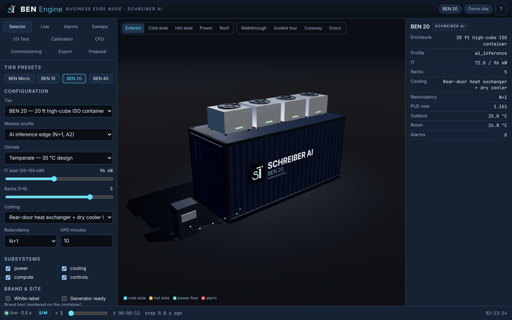

# BEN Engine dashboard

One screen for a deployed BEN unit: live data, the 3D digital twin, a first-person walkthrough and
guided tour, automated sweeps, fault injection, I/O point tests, calibration, CFD, commissioning and
CSV export. It runs with **no hardware** in simulation mode and is served by the same FastAPI app
that a gateway runs on site (`software/ben_engine/api.py`).



## Run

```bash
pip install fastapi uvicorn websockets        # Python 3.11+
scripts/run_dashboard.sh                      # http://localhost:8080  (API docs at /docs)
# or
PYTHONPATH=software uvicorn ben_engine.api:app --host 0.0.0.0 --port 8080
```

Everything is static vanilla JS (ES modules, no build step) under `dashboard/static/`. three.js
0.170.0 is vendored in `static/vendor/three/`; **nothing is loaded from a CDN**, so the page works
offline inside the container's isolated controls LAN.

Tests:

```bash
PYTHONPATH=software pytest tests/test_api.py -q      # API contract (FastAPI TestClient)
bash tests/e2e/run_e2e.sh                            # Playwright: loads the UI, changes tier, injects a fault,
                                                     # runs a sweep + CSV download, screenshots + tour frames
```

The e2e run writes `docs/media/screens/*.png` (desktop exterior iso, interior walkthrough, alarms,
sweeps, selector micro / BEN 40, 390 px narrow) and 24 ordered guided-tour frames to
`docs/media/frames/tour-NN.png` for the README GIF.

## What is simulated vs live

| Area | Simulation mode (default) | Live (gateway) |
| --- | --- | --- |
| Telemetry | One `ben_engine.twin.Twin` stepped by the server at 1 Hz real time; `POST /api/sim/speed {x}` runs 1–60 simulated s per real s. State is pushed on `WS /ws/state` once per second. | The BEN Controller edge computer normalises MQTT Pod telemetry (BEN Mesh), PLC data and Modbus/SNMP equipment data onto the same `twin/state` shape (see `spec/PROTOCOL.md`, adapters in `firmware/ben-edge`). |
| Sensors | `Twin.sensors()` positions, uncertainties (U95, k=2) and node assignment; values carry Gaussian sensor noise and the injected `sensor_drift`. | Real DS18B20 / SHT45 / SDP810 / ADS1115 channels per node; same ids. |
| Alarms | Computed by the twin from the ASHRAE class of the mission profile. | Gateway alarm engine, same ids/severities. |
| I/O test | `ben_engine.sim_nodes.NodeFleet`: virtual BEN nodes answer `set_output`, `identify`, `tare`, `get_cal`, `set_cal`, `reboot` on an in-process bus and report raw ADC counts next to calibrated values. | Same commands over MQTT `ben/<unit>/node/<id>/cmd`, acks on `/ack`; latency is the real round trip. |
| Sweeps | `ben_engine.sweeps` runs each scenario on a fresh twin in a background thread (pollable `GET /api/sweeps`). A builtin fallback set exists so the sequence still runs if the module is missing. | Not run against live units from the dashboard; sweeps are a commissioning / twin tool. |
| Calibration | `ben_engine.calibration.linear_fit` + GUM budget; "apply" moves the twin's reported drift. | `set_cal` is sent to the node (coefficients stored in NVS with a `cal_id`). |
| CFD | `ben_engine.cfd.run_cfd` (2D LBM) per tier in a background thread; PNG + metrics; "apply" copies the recirculation profile into the twin. | Same (design tool). |
| Commissioning | `ben_engine.commissioning.Commissioning(sim=True)`; steps stream into the panel; report under `docs/reports/`. | `commissioning.run_live(url)` — connectivity placeholder; the on-site sequence is run step by step with a person at the panel. |
| Export | Server ring buffer (6 h at 1 s) → `GET /api/export.csv?from=&to=` or `?last=<s>`; JSON variant. | Gateway database is the long-term record; the same endpoint serves its rows. |

**Connecting a real gateway.** This build has no live adapter wired to the dashboard yet. The URL
setting exists so the UI can be pointed at a gateway: `POST /api/sim/mode {"mode":"live",
"gateway_url":"http://10.77.0.1:8080"}` records the URL and flips the status strip to LIVE; the
twin keeps simulating and the response says so. On a gateway you run this same server; the MQTT and
Modbus adapters described in `firmware/ben-edge` feed `RT.twin`'s state in place of `Twin.step()`.

## Layout

- **Top bar**: SAI monogram, `BEN Engine` wordmark, tier pill, site name.
- **Left rail**: Selector · Live · Alarms · Sweeps · I/O Test · Calibration · CFD · Commissioning · Export.
- **Centre**: 3D viewport with camera presets, Walkthrough, Guided tour, Cutaway and Doors toggles.
- **Right inspector**: the selected object's live values and *evidence* (sensor id, value, U95, node, last update).
- **Status strip**: WebSocket health (dot = live when a state arrived in the last 4 s), SIM/LIVE,
  sim speed slider, simulated time, age of the last twin step, wall clock.

Below 900 px the panels stack (viewport, rail, inspector); it is checked at 390 px by the e2e test.
`prefers-reduced-motion` disables particle, pulse, door, fan and camera animation; the tour becomes
discrete stops and alarm highlights are static.

## The 3D twin

Built procedurally from `/api/config` + `/api/sensors` every time the configuration changes:

- ISO container shell with correct external dimensions, corrugated side walls (displaced geometry),
  corner castings, bottom rails, insulated liner, door-end doors that open (toggle or `door_open` fault),
  brand text and the SAI monogram as a canvas texture on both long sides (white-label text replaces it).
- Power bay at the door end (UPS modules, battery cabinets, ATS and distribution panel on the wall),
  utility pedestal outside, generator skid when fitted. Rack row with server fronts whose glow follows
  `pdu_kw`, cold aisle (cyan) and hot aisle (amber) volumes, containment doors, raised cable tray,
  gateway/network cabinet on the cold wall.
- Cooling: in-row DX cabinets packed into the row (extras wall-mounted), cabinet DX on the Micro,
  CDU + manifolds + roof dry coolers (spinning fans at `fan_pct`) for RDHx / DLC.
- Sensors as spheres coloured by live value; airflow particles cold → rack → hot → unit at fan speed
  and air temperature; power pulses utility → ATS → UPS → panel → tray → racks at kW, amber on
  battery, red when utility is lost and SoC < 30 %.
- Alarms outline their object (pulsing; static under reduced motion). Clicking anything fills the inspector.
- Subsystem toggles in the Selector hide whole modules so "power only" / "cooling only" render correctly.

Coordinate note: the twin's sensor frame is x along the length from the door end, y across the width
(negative = cold side), z up. The scene maps it to three.js (x centred, y up, z = width) and moves
rack sensors with their rack when the row is packed behind the power bay.

## Keyboard and mouse

| Key | Action |
| --- | --- |
| drag / wheel | orbit / zoom (orbit mode) |
| click object | inspect it |
| `1`–`5` | camera presets: exterior iso, cold aisle, hot aisle, power, roof |
| `F` | walkthrough (first person): `W A S D` / arrows move, `Shift` run, mouse look, `Esc` exit |
| `G` | guided tour on / off (captions narrate each subsystem) |
| `C` | cutaway on / off (roof and near wall become transparent; shadows stay) |
| `Esc` | leave walkthrough / tour |
| `?` button | this table |

`window.__ben` exposes `store`, `scene` (`rackCount()`, `setCamera()`, `enterWalk()`, `tour.seek()`),
`api` and `showPanel()` for tests and consoles.

## API

See `spec/INTERFACES.md`; the server adds `GET /api/health`, `GET /api/sensors`, `POST /api/sim/speed`,
`POST /api/sim/mode`, `POST /api/outdoor`, `POST /api/config/validate`, `GET /api/sweeps/catalog`,
`GET /api/sweeps/{id}`, `GET /api/export.json`, `GET /api/export/range`, `POST /api/calibrate/apply`,
`POST /api/cfd/run`, `POST /api/cfd/apply`, `GET /api/commission/status`, `GET /api/commission/report`
and `DELETE /api/faults`. Optional modules that are not importable answer `503 "<module> module not yet
available"`; `/api/health.modules` lists which ones are present.
