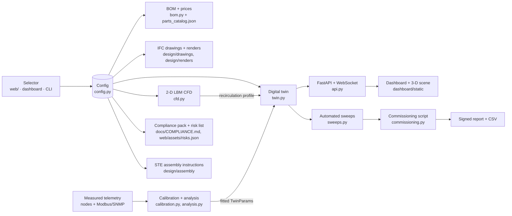

# Architecture

## The one idea
A **configuration** (`spec/ben-config.schema.json`, produced by the selector) is the root of everything. Every deliverable is a function of it.



## Runtime inside a deployed unit
```mermaid
flowchart TB
  subgraph Controls VLAN (IEC 62443 zone 1)
    GW[BEN Gateway · Raspberry Pi 5<br/>Mosquitto · ben_engine.api · SQLite · chrony]
    N1[BEN Node 1 · ESP32-S3<br/>room, supply/return, dP, leak, door]
    N2[BEN Node 2..n · racks]
    PM[Power meter · Modbus RTU]
    UPS[UPS · Modbus TCP/SNMP]
    CU[Cooling units · Modbus]
    PDU[Rack PDUs · SNMP]
    N1 & N2 -->|MQTT JSON 1 Hz| GW
    PM & UPS & CU & PDU -->|poll| GW
  end
  subgraph Life safety (hardwired, no network)
    SD[Smoke detection] --> REL[Clean-agent release panel]
    EPO[EPO buttons] --> SHUNT[Shunt-trip breakers]
    REL -.dry contact.-> N1
    EPO -.dry contact.-> N1
  end
  subgraph Customer IT (zone 2, isolated)
    SRV[Racks / servers / GPUs]
  end
  OPS[Operator browser<br/>local or VPN] -->|HTTPS/WS| GW
  GW -. outbound-only support tunnel (optional) .-> SAI[Schreiber AI ops]
```

## Components and contracts
| Component | Owns | Interface | Persistence |
| --- | --- | --- | --- |
| `config.py` | Tiers, profiles, climates, sizing rules, validation | `Config`, `derived()` | JSON file per unit |
| `twin.py` | Physics state, faults, alarms, sensor specs | `step()`, `state()`, `inject()` | none (deterministic from config + seed) |
| `cfd.py` | Airflow/temperature fields, recirculation index | `run_cfd()`, `recirculation_profile()` | PNG + metrics JSON |
| `calibration.py` | Fits, tares, uncertainty budgets | `linear_fit()`, `budget()` | cal records (JSON) with `cal_id` |
| `analysis.py` | Parameter fitting, prediction intervals, margins | `fit_params()`, `predict()` | fitted params JSON |
| `sweeps.py` | Test sequences with pass/fail | `run(name, twin)` | CSV per sweep |
| `commissioning.py` | FAT/SAT procedure | CLI | signed Markdown report + CSV hash |
| `api.py` | HTTP/WS surface, ring buffer, background sim | see `spec/INTERFACES.md` | SQLite (gateway), in-memory (demo) |
| `dashboard/static` | UI, 3-D scene, panels | REST + WS | browser only |
| `firmware/ben-node` | Measurement, calibration apply, outputs, buffering | MQTT per `spec/PROTOCOL.md` | NVS (cal, ids) |
| `firmware/ben-gateway` | Broker, services, backups, firewall | systemd | SQLite + nightly backup |

## Trust boundaries
1. Life-safety never crosses into software. Nodes only *observe* dry contacts.
2. Controls VLAN has no route to customer IT or to the internet by default.
3. Firmware images are signed; calibration changes carry a `cal_id` and are logged.
4. The dashboard shows a connection indicator that follows a real WebSocket heartbeat and last-step age, never a static green light.

## Failure behaviour
| Failure | Behaviour |
| --- | --- |
| Gateway down | Nodes keep measuring and buffering 1 h; outputs hold or fail safe per table in `design/specs/CONTROLS_SPEC.md`; cooling units run on their own controllers |
| Node down | Twin falls back to neighbouring sensors; alarm "sensor loss"; commissioning blocks until fixed |
| Utility loss | UPS carries IT; cooling rides through only with the mechanical-UPS option; twin predicts minutes to ASHRAE limit |
| Cooling unit fail | Standby unit starts (N+1/2N); alarm; sweep `cooling_unit_failover` is the acceptance test |
| Leak | Critical alarm; CDU isolates (liquid tiers); procedure in maintenance docs |
