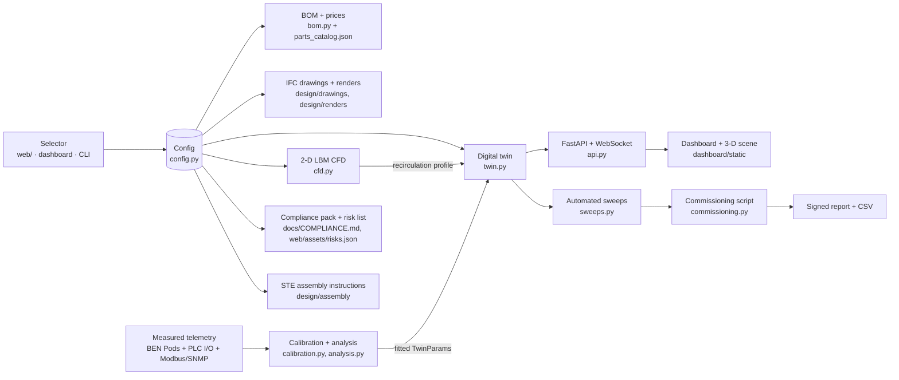

# Architecture

## The one idea
A **configuration** (`spec/ben-config.schema.json`, produced by the selector) is the root of everything. Every deliverable is a function of it.



## Runtime inside a deployed unit
```mermaid
flowchart TB
  subgraph BEN Controller panel (UL 508A · IEC 62443 zone 1)
    PLC[PLC · Phoenix Contact PLCnext AXC F 2152<br/>Axioline F I/O: DI/DO, RTD, 4–20 mA<br/>interlocks, failover, watchdog relay]
    EDGE[Edge computer · OnLogic Karbon 400, TPM 2.0<br/>Mosquitto · ben_engine.api · SQLite · OTBR · chrony]
    SW[Managed switch · FL SWITCH 2008]
    PLC <-->|Modbus TCP / OPC UA| EDGE
    PLC --- SW
    EDGE --- SW
  end
  subgraph BEN Mesh (Thread / IPv6, 2.4 GHz)
    RCP[MGM240P border router RCPs ×2 on USB]
    PW[BEN Pod W · rack cold/hot faces<br/>4 × Pt1000, SHT45, attested]
    PE[BEN Pod E · room + outdoor<br/>RS-485 to PLC, Thread router]
    PW & PE -->|MQTT/JSON over DTLS/TLS 1 Hz| RCP
    RCP --> EDGE
    PE -.Modbus RTU.-> PLC
  end
  subgraph Wired transmitters on the PLC
    TX[Pt1000 supply/return · Setra 264 dP<br/>Vaisala HMW90 RH · RLE LD2100 leak]
    TX --> PLC
  end
  subgraph Vendor equipment (zone 1 VLAN)
    PM[Power meter · Modbus RTU]
    UPS[UPS · Modbus TCP/SNMP]
    CU[Cooling units · Modbus]
    PDU[Rack PDUs · SNMP]
    PM & UPS & CU & PDU -->|poll| EDGE
    CU -.enable / status.- PLC
  end
  subgraph Life safety (hardwired, no network)
    SD[Smoke detection] --> REL[Clean-agent release panel]
    EPO[EPO buttons] --> SHUNT[Shunt-trip breakers]
    REL -.dry contact.-> PLC
    EPO -.dry contact.-> PLC
  end
  subgraph Customer IT (zone 2, isolated)
    SRV[Racks / servers / GPUs]
  end
  OPS[Operator browser<br/>local or VPN] -->|HTTPS/WS| EDGE
  EDGE -. outbound-only support tunnel (optional) .-> SAI[Schreiber AI ops]
```

Two controls tiers run this architecture (`docs/CONTROLS_HARDWARE_DECISION.md` §2a, `Config.controls_tier`): **BEN Controls Pro** (BEN 20/40, selectable on BEN 10) is the diagram above. **BEN Controls Lite** (BEN Micro, default on BEN 10) replaces the PLC + edge computer pair with one DIN-rail **Revolution Pi RevPi Connect 4** with RevPi DIO/AIO modules: it runs `ben_engine`, the broker, the border router and the interlock logic in software behind a hardware watchdog relay. Same Pods, same mesh, same protocol, same dashboard; life safety is hardwired in both.

## Components and contracts
| Component | Owns | Interface | Persistence |
| --- | --- | --- | --- |
| `config.py` | Tiers, profiles, climates, sizing rules, validation | `Config`, `derived()` | JSON file per unit |
| `twin.py` | Physics state, faults, alarms, sensor specs | `step()`, `state()`, `inject()` | none (deterministic from config + seed) |
| `cfd.py` | Airflow/temperature fields, recirculation index | `run_cfd()`, `recirculation_profile()` | PNG + metrics JSON |
| `calibration.py` | Fits, tares, uncertainty budgets | `linear_fit()`, `budget()` | cal records (JSON) with `cal_id` |
| `analysis.py` | Parameter fitting, prediction intervals, margins | `fit_params()`, `predict()` | fitted params JSON |
| `sweeps.py` | Test sequences with pass/fail | `run(name, twin)` | CSV per sweep |
| `commissioning.py` | FAT/SAT procedure | CLI | signed Markdown report + CSV hash |
| `api.py` | HTTP/WS surface, ring buffer, background sim | see `spec/INTERFACES.md` | SQLite (edge computer / RevPi), in-memory (demo) |
| `dashboard/static` | UI, 3-D scene, panels | REST + WS | browser only |
| `firmware/ben-pod` (BEN Pod, MGM240P / OpenThread) | Measurement, calibration apply, outputs, buffering, attestation | MQTT per `spec/PROTOCOL.md` over Thread/IPv6 | Secure Vault NVM (cal, ids, device certificate) |
| `firmware/ben-edge` (edge computer / RevPi image) | Broker, OTBR, services, backups, firewall, TPM measured boot | systemd | SQLite + nightly backup |
| PLC project (PLCnext, `firmware/ben-edge/plc`) | Interlocks, cooling failover, leak isolation, watchdog relay, life-safety monitoring | Modbus TCP / OPC UA to the edge computer | PLC retentive memory |

## Trust boundaries
1. Life-safety never crosses into software. The PLC (or RevPi) and the Pods only *observe* dry contacts.
5. Hardware root of trust end to end: every Pod attests at join (Secure Vault High, per-device certificate), every firmware image is signed, the edge computer measures its boot with a TPM; the controls zone has no route to the internet.
2. Controls VLAN has no route to customer IT or to the internet by default.
3. Firmware images are signed; calibration changes carry a `cal_id` and are logged.
4. The dashboard shows a connection indicator that follows a real WebSocket heartbeat and last-step age, never a static green light.

## Failure behaviour
| Failure | Behaviour |
| --- | --- |
| Edge computer down | PLC keeps the interlocks; Pods keep measuring and buffering 1 h; outputs hold or fail safe per table in `design/specs/CONTROLS_SPEC.md`; cooling units run on their own controllers |
| PLC / RevPi down | Watchdog relay drops within 5 s: cooling units fall back to local control (cooling enable is wired fail-ON); edge computer raises the alarm; commissioning proves it (CTP-K2) |
| Pod down or mesh partition | Thread mesh self-heals around a lost router Pod (E13); twin falls back to neighbouring sensors; alarm "sensor loss"; commissioning blocks until fixed |
| Rogue device on the mesh | Join rejected (no valid certificate / attestation); event logged; E12 tests it |
| Utility loss | UPS carries IT; cooling rides through only with the mechanical-UPS option; twin predicts minutes to ASHRAE limit |
| Cooling unit fail | Standby unit starts (N+1/2N); alarm; sweep `cooling_unit_failover` is the acceptance test |
| Leak | Critical alarm; CDU isolates (liquid tiers); procedure in maintenance docs |
