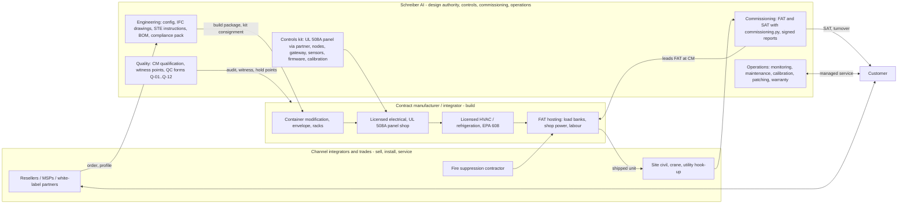

# BEN Engine — Manufacturing Strategy: third parties first

**Owner:** Schreiber AI operations. **Decision (operator, 2026-11-08):** BEN Engine units are built by qualified **contract manufacturers (CMs)** — container modification shops, modular electrical skid builders and data-center integrators with licensed trades — from Schreiber AI's engineering package and controls kit. Schreiber AI stays the **design authority**, builds and tests the **controls kit**, leads **FAT and SAT**, and runs **operations**. A Schreiber AI greenfield factory is a **later phase, to be studied** only after the CM model is running (§10, §11). Process detail lives in `docs/PROCESS_FLOW.md`; this document says why, with whom, and how we keep quality in a shop we do not own.

## 1. Why third parties first

| Reason | What it means for BEN Engine |
| --- | --- |
| **Capital** | A container fit-out shop needs a 2,000–4,000 m² high bay with a 10–20 t crane, paint booth, welding bays, 480 V test power and load banks — on the order of US$ 3–8 M before the first unit, plus 12–18 months. The CM already has it. Our capital goes into engineering, the controls layer, test equipment and working capital for long-lead equipment. |
| **Speed** | A qualified CM can start the first unit as soon as the engineering package is released. The schedule in `PROCESS_FLOW.md` §3 is set by long-lead equipment (12 weeks), not by shop capacity. |
| **Certification leverage** | The CM brings what takes years to build: a **UL 508A panel-shop listing** (or a sub that has one), **AWS D1.1 certified welders and a CWI**, **licensed electricians and HVAC/refrigeration technicians with EPA 608**, state contractor licences, insurance, and often ISO 9001. Our controls cabinet gets its UL 508A label through the CM's or our panel partner's file; our structural modifications get a CWI signature from their program. |
| **Scale up and down** | Demand for a new product is lumpy. CMs absorb 0–3 units a month without us carrying idle labour. |
| **Geography** | Containers are expensive to ship; a CM near the pilot customers (and later regional CMs) cuts freight and crane cost and lets Schreiber AI engineers be present. |
| **Learning before we build** | Every unit at a CM teaches us cycle times, defect types and tooling needs with real numbers; the greenfield study (§11) is then based on data, not guesses. |

What we do **not** outsource: configuration and sizing (`config.py`), drawings and the STE instructions, the controls kit (hardware assembly, calibration, firmware), the commissioning script and the signed FAT/SAT, compliance packs, customer operations and remote support. These are the product; the shell and the fit-out are the delivery.

## 2. The manufacturing model

Roles in one line each: **Schreiber AI** owns what the unit *is* and proves that it works; the **CM** owns that it is *built* to the package, with its own licences and QC; **integrators** sell it, prepare the site and install it; **certified subs** (fire, PE, CWI, NRTL field evaluation) sign what the law requires a third party to sign.

## 3. Types of shops to approach

| Type | What they bring | What they lack (we supply) | Best fit |
| --- | --- | --- | --- |
| **Container modification companies** | Volume cutting/framing, insulation, liner, doors, paint; many have electricians and climate-control experience; fast and cheap on the shell | Data-center-grade electrical (480 V switchgear, UPS), refrigeration, controls, test | BEN 30 / BEN 150 shell and fit-out; BEN 5 skid assembly |
| **Modular electrical skid / e-house / PDC builders** | UL 508A panel shops, 480 V switchgear integration, licensed electricians, testing culture, steel fabrication, often ISO 9001 | Container-specific envelope work, HVAC/refrigeration | BEN 150 / BEN 500 power module and controls panel; can be the primary CM if they take the shell too |
| **Data-center / containerized DC integrators and metal-intensive contract manufacturers** | Have built containerized data centers; understand cooling, hot-aisle containment, commissioning; some offer field installation | Cost (higher margin), may compete with us, IP exposure | BEN 500 first articles; overflow capacity; export units |

### 3.1 Named US candidates found by web search (2026-11-08)

Capabilities below are **as listed on their own sites or in search snippets**; nothing here has been verified by audit. These are candidates for the RFI (`purchasing/email_queue/16-contract-manufacturer-rfi.md`), not approved suppliers.

| # | Company | Type | Location (as listed) | Capabilities as listed | Source |
| --- | --- | --- | --- | --- | --- |
| 1 | **Falcon Structures** | Container modification | Manor / Austin, Texas | B2B modified containers (quick-ship, pre-designed, fully custom); cutting and framing, joining and stacking, climate control, electrical outfitting; "special container projects" needing deeper engineering "within parameters we can manufacture and certify" | https://www.falconstructures.com/capabilities-qualifications ; https://www.falconstructures.com/modular-shelters ; https://www.falconstructures.com/about-us |
| 2 | **Conexwest** | Container modification | Northern California, ships nationwide | Doors, windows, insulation, custom fabrication; states ISO 9001 and AWS certification; lists modular data centers, crypto-mining infrastructure and edge computing among custom fabrication applications (incl. an Oklahoma data-center article) | https://www.conexwest.com/blog/modified-shipping-containers-ultimate-guide-fabrications ; https://www.conexwest.com/blog/shipping-container-data-centers-oklahoma-modular-infrastructure-ai-cloud-hpc |
| 3 | **SW Mobile Storage** | Container modification | US (multi-site) | States a 90,000 sq ft fabrication facility with certified welders and electricians; handles large project pipelines | https://faq.swmobilestorage.com/i-have-a-large-project-in-the-pipeline.-would-you-be-able-to-handle-it |
| 4 | **Craftsmen Industries** | Container / specialty vehicle fabrication | US | Design, engineering, fabrication and paint under one roof; designs "engineered to meet building codes, safety standards" | https://www.craftsmenind.com/?p=12120 |
| 5 | **Strick Trailers (fabrication division)** | Fabricated enclosures | Northeast, Southeast, Midwest facilities | Positions itself as a single-source partner for "fabricated data center enclosures, fixtures and bases" | https://www.stricktrailers.com/fabrication/ |
| 6 | **Wunderlich-Malec** | Modular electrical / integrated enclosures, panel shops | Minnesota and Maine | Protective relay and control panels, skid-mounted control houses, modular integrated enclosures, process skids; panel shops in MN and ME | https://www.wmeng.com/control-panels/ ; https://www.wmeng.com/?p=147 |
| 7 | **Encore Electric (fabrication)** | Modular electrical | US (Colorado-based contractor) | Modular construction of portable distribution centers (PDCs), modular substations and portable electric buildings | https://www.encoreelectric.com/services/fabrication/ |
| 8 | **McIver Engineering & Controls** | UL 508A panel shop | US | UL 508A certified panel manufacturer (control panels, not full skids) — candidate for our controls-panel label if the primary CM has no panel shop | https://mcivereng.com/?p=351 |
| 9 | **Columbia Tech (Coghlin Companies)** | Contract manufacturer / containerized systems | Massachusetts | States it manufactured one of the largest containerized modular data center projects ever produced; design, DFM, contract manufacturing, transport, installation and field support | https://www.coghlincompanies.com/?p=615 |
| 10 | **Prince Manufacturing** | Metal-intensive contract manufacturer for data-center OEMs | USA / Mexico footprint | Fabrication, coating and assembly under one roof; positions itself as a contract manufacturing partner for data center OEMs | https://princemanufacturing.com/data-centers/ |
| 11 | **MCF International (MCFI)** | Containerized / modular data center provider | US | Turnkey modular and containerized data centers; ISO containers modified for IT equipment (potential partner **or** competitor — approach for overflow only) | https://mcfintl.com/services/containerized-data-center-solutions/ |

Not found / not confirmed in this search: current details for BMarko Structures and Giant Containers (names appear only in market reports); Vertiv and other OEMs sell complete prefabricated data centers and are suppliers of equipment, not CMs for us.

## 4. CM selection criteria and scoring

Score each criterion 1–5; weight as shown; a CM needs ≥ 70/100 and no "gate" failure to proceed to a site audit. Gates: valid licences and insurance, willingness to sign NDA/IP terms, access to a UL 508A panel shop (own or named sub), AWS D1.1 welders with a CWI available.

| Criterion | Weight | 5 looks like | 1 looks like | Evidence requested in RFI |
| --- | --- | --- | --- | --- |
| **Capabilities** — container cutting/framing, insulation/liner, 480 V electrical, refrigeration, paint booth, indoor high bay, 10–20 t crane, 480 V test power ≥ 400 A, load banks | 20 | All in-house incl. 480 V test power and load banks | Shell only, outsources electrical | Facility list, photos, equipment list |
| **Certifications and licences** — UL 508A panel shop (own file), AWS D1.1 welders + CWI, state electrical/HVAC licences, EPA 608 techs, ISO 9001, NRTL field-evaluation experience | 20 | UL 508A file + ISO 9001 + CWI on staff | None in-house | Certificates, UL file number, licence numbers |
| **Capacity** — bays, shifts, units/month available to us, ability to hold a bay for 6–8 weeks per BEN 150 | 10 | ≥ 3 BEN 150 bays, 2 shifts | 1 bay shared with other customers | Capacity statement, current backlog |
| **Distance to pilot sites and freight** | 10 | < 500 km from the first three sites; rail/road access; crane on site | > 2,000 km | Address, dock and crane details |
| **References** — containerized data center, e-house or telecom shelter work in the last 3 years; customer contacts | 15 | ≥ 3 relevant references, contactable | None relevant | Reference list, photos |
| **Quality system** — documented QC, calibration of torque tools and meters, NCR process, traceability, willingness to use our Q-01..Q-12 | 10 | ISO 9001 with calibrated tools and NCR log | Informal | Quality manual, calibration records |
| **Financial health** — years in business, revenue scale vs our order (we should be < 30 % of their revenue), credit report, bonding capacity | 10 | > 10 years, D&B rating acceptable, bondable | < 3 years or we would be > 50 % of revenue | Financial statements under NDA, D&B |
| **Commercial terms** — margin transparency (open-book preferred), consignment acceptance, progress-payment schedule tied to hold points, warranty on workmanship ≥ 24 months | 5 | Open book, accepts consignment and hold-point payments | Fixed lump sum, no visibility | Draft terms |
| **Total** | 100 | | | |

## 5. Qualification process (RFI → audit → first article → pilot)

| Step | What happens | Who | Duration | Exit |
| --- | --- | --- | --- | --- |
| **1. RFI** | Send `16-contract-manufacturer-rfi.md` to 6–10 candidates; score responses with the §4 table | Schreiber AI purchasing + quality | 3 weeks | ≥ 3 candidates ≥ 70 points |
| **2. NDA and package preview** | NDA with IP terms (§9); share one tier's drawing set and STE instructions for a buildability review and a budgetary quote | ENG + candidate | 2 weeks | Budgetary quote within our cost model (§7) |
| **3. Site audit** | 2-day visit: facility walk, certificates verified (UL file, welder certs, licences), tool calibration records, a sample weld test, a sample 480 V termination, review of their last three projects' QC records, interview of the shop lead | Schreiber AI quality + ENG | 2 days + report 1 week | Audit score ≥ 70; no gate failures; corrective actions agreed |
| **4. Quality agreement** | Signed document: our drawings and forms govern; hold/witness points; NCR and deviation process; traceability; access rights; consignment handling; warranty; change control (no substitution without ENG approval) | Both | 2 weeks | Signed |
| **5. First article (FAI)** | One unit of the tier (usually a BEN 150) built with Schreiber AI engineering present full time; every CTQ measured; every Q form completed; FAT run by Schreiber AI; a formal first-article inspection report; lessons fed back into the drawings and STE instructions | CM + ENG + quality | One build cycle (~16 weeks incl. long-lead; shop time ~10 weeks) | FAI report signed; CM approved for that tier |
| **6. Pilot units** | Next 2–3 units with reduced presence (witness points only); defect and cycle-time data collected; CM scorecard updated quarterly | CM + quality | 2–3 build cycles | Defect rate and cycle time inside targets (§10); CM moves to "approved, standard surveillance" |

A second CM is qualified before unit 10 to avoid single-source risk (§9).

## 6. Quality plan at a third party

### 6.1 What Schreiber AI supplies to the CM

| Item | Form | Notes |
| --- | --- | --- |
| IFC drawing set with CTQ/CTP callouts | PDF + native | Every CTQ carries a tolerance and a check method; drawings are revision-controlled; the CM builds only to the released revision |
| STE assembly instructions (`design/assembly/`) | PDF, one action per step | Written for a worker with no data-center experience; the CM's leads are trained on them at the first article |
| BOM split: Schreiber AI-supplied vs CM-supplied, with approved alternates | CSV | Substitutions need written ENG approval (change control) |
| QC forms Q-01..Q-12 pre-filled with serial and tolerances | PDF + CSV template | Returned signed; countersigned by Schreiber AI quality before the next hold point |
| **Controls kit** (consigned) | Crate with packing list | UL 508A-labelled controls panel, calibrated nodes with `cal_id`, imaged gateway, sensor strings, cut-and-labelled cables, dP tubing, installation sheet; bench-tested 100 % before shipping |
| Long-lead and listed equipment (consigned or drop-shipped to the CM) | — | UPS, switchgear, in-row/CDU, batteries, fire system, racks; receiving inspection by the CM on our form |
| Commissioning script and FAT procedure (`TEST_GUIDE.md`) | Software + PDF | Run by Schreiber AI engineers on our laptop against the unit; the CM provides load banks, power and labour |
| Compliance pack excerpts (refrigerant spec, torque table, labelling scheme, colour codes) | PDF (`BUILD_AND_WIRING.md`) | |
| Training | 2 days at first article | Shop leads trained on the STE instructions, forms and hold points |

### 6.2 What Schreiber AI witnesses (from `PROCESS_FLOW.md`)

| Point | First article | Standard surveillance (after FAI and pilots) |
| --- | --- | --- |
| W6 container receiving | Present | Remote photo review |
| H7 weld inspection | Present with CWI | CWI report review; present on every BEN 500 |
| W8 insulation before liner | Present | Photo witness within 24 h |
| H10a rough-in | Present | Remote |
| H10b torque/megger | Present | Present |
| H11 pressure/evacuation | Present | Spot check (1 in 3 units) |
| W12 I/O point-to-point | Present (ENG runs it) | Remote-guided, ENG signs |
| H13 FAT | ENG + quality full time | ENG + quality full time (FAT is always ours) |
| Q-10 shipping release | Present | Photo review |

### 6.3 Defect handling

Non-conformances are raised on the CM's NCR form or ours; disposition (use-as-is with ENG approval, rework, scrap) is Schreiber AI's call for anything touching a CTQ. Defects are classified **critical** (safety, listing, CTQ out of tolerance), **major** (function or durability), **minor** (cosmetic, documentation). Rates per unit feed the scorecard and the greenfield transition criteria (§10).

## 7. Cost model

| Element | Basis | Bracket |
| --- | --- | --- |
| **CM scope** | Shell modification, envelope, mechanical fit-out, electrical installation, cooling installation, controls kit mounting, FAT hosting, transport prep: labour + CM-supplied materials | Labour ≈ 600–900 h for a BEN 150 (first articles 1.5×); CM-supplied materials (container, steel, insulation, liner, wire, raceway, paint, consumables) ≈ US$ 35–60 k per BEN 150 at today's BOM estimates |
| **CM margin** | On labour and CM-supplied materials only; **not** on consigned equipment | **15–25 %** on labour and their materials (open-book target 18 %); a handling fee of 2–4 % on consigned equipment if they receive and store it |
| **Schreiber AI-supplied (consigned)** | UPS, switchgear, cooling units, CDU, batteries, fire system, racks, controls kit — the majority of unit cost | Consigned at our cost; title stays with Schreiber AI; insured by us while at the CM; this keeps 60–70 % of the unit's material cost out of the CM margin base |
| **Progress payments to CM** | Tied to hold points | 20 % at container receipt (Q-01), 30 % at H7+H10b, 30 % at H13 FAT, 20 % at shipping release (Q-10); retention 5 % until SAT |
| **Schreiber AI engineering and commissioning** | Per unit: engineering release, kit build/test, FAT (3 days × 2 people), SAT (5 days × 2), travel | Recovered in the unit price as a line, not hidden in margin |
| **Freight** | Container as cargo on flatbed; CM near pilot sites | Distance-driven; the reason distance is a scored criterion |
| **Effect on unit economics** | The CM margin applies to roughly 30–40 % of the unit cost; the blended effect on total unit cost vs. own factory is **+6–10 %**, in exchange for no factory capex and no idle labour | Updated from real quotes in `docs/BOM.md` once RFIs return |

## 8. Capacity and sourcing plan

| Phase | Units/year | CMs | Notes |
| --- | --- | --- | --- |
| Pilot (first 12 months) | 3–6 | 1 primary (BEN 30/20), 1 panel-shop partner for the controls kit if the primary has no UL 508A file | First article + pilots; Schreiber AI presence high |
| Ramp (year 2) | 10–25 | 2 CMs (second qualified before unit 10), one capable of BEN 500 | Regional split by pilot-site geography; frame agreements with reserved bay-weeks |
| Scale (year 3+) | 25–60 | 2–3 CMs; decision point for greenfield (§10) | |

## 9. Risks and mitigations

| Risk | Likelihood | Mitigation |
| --- | --- | --- |
| **IP leakage** — the CM learns the design and builds for a competitor, or a CM is itself a containerized-DC vendor | M | NDA with IP assignment for any improvement to our drawings; drawings watermarked per CM and unit; **the controls kit, firmware, config model and commissioning script never leave Schreiber AI** (the CM mounts a sealed panel and runs no software); split sourcing so no single CM sees the whole BEN 500 power + controls design unless needed; prefer shops that are not DC vendors for the primary role |
| **Capacity allocation** — our bay is bumped by a larger customer | M | Frame agreement with reserved bay-weeks and penalties; second CM qualified before unit 10; long-lead equipment held by us so a unit can move shops |
| **Quality drift** after the first articles | M | Hold points never waived; Q forms countersigned; FAT always run by Schreiber AI; quarterly scorecard; surveillance increases after any critical NCR; re-FAI after 6 months without a build or after key-person change |
| **CM financial failure** mid-build | L | Consigned equipment titled to Schreiber AI and tagged; progress payments behind work; right to remove the unit and equipment; second CM |
| **Listing/licence lapses** (UL 508A file, electrical licence) | L | Certificates verified at audit and annually; UL file number on every panel label checked at FAT |
| **Schedule dependence on long-lead equipment** (not CM) | H | Schreiber AI buys long-lead at engineering release; approved alternates; small stock of controls hardware |
| **Field-evaluation demand by AHJ** on a non-listed assembled unit | M | Component listings + UL 508A panel + optional NRTL field evaluation budgeted (`COMPLIANCE.md` §3) |
| **Cost creep** in CM quotes once they see the volume is small | M | Open-book pricing; labour hours tracked per unit; benchmark against a second CM |

## 10. Transition criteria to a greenfield factory

The greenfield study starts only when **all** of the following hold for two consecutive quarters, and the business case shows payback < 4 years:

| Criterion | Threshold |
| --- | --- |
| Shipped volume | ≥ 25 units/year (BEN 150-equivalent) with a firm backlog ≥ 12 months |
| CM cost premium | CM labour + margin per unit ≥ 10 % of unit cost **and** equivalent own-factory cost (with realistic utilisation ≥ 60 %) is lower by ≥ US$ 25 k per BEN 150-equivalent |
| Lead time | CM shop time is on the critical path (i.e. shop time > long-lead equipment time) for ≥ 50 % of units, or CM capacity constrains bookings |
| Quality | Critical defects at FAT ≤ 0.2 per unit and major ≤ 1.0 per unit at the CMs — the process is stable enough to transplant; **or** persistent quality drift that two CMs cannot fix |
| Product stability | Drawing changes < 5 % per quarter; the STE instructions have not changed in substance for 2 quarters |
| Funding | Capex (§11) funded without starving engineering and operations |

If the criteria are not met, the right answer is a third CM or a dedicated bay inside a CM (a "factory within a factory"), not a greenfield plant.

## 11. Greenfield outline — later phase, to be studied

**Status: later phase — to be studied. Nothing below is a plan or a commitment; it is the shape of the question.**

| Item | Outline | Basis |
| --- | --- | --- |
| Size | 3,000–4,500 m² high bay (clear height ≥ 9 m, one 20 t and one 10 t bridge crane), 500 m² offices/lab, 2,000 m² yard with container storage and a test pad | A BEN 150 cell needs ~80 m² plus access; 6 cells plus receiving, paint and test ≈ 3,000 m² |
| Cells | Receiving & structural (cutting/welding, fume extraction); envelope (insulation/liner); paint booth (ISO 12944 systems, C5 capable); electrical fit-out ×2; cooling/fluids; controls & FAT bays ×2 with 480 V 1,200 A test power, load banks to 500 kW, a heat-rejection yard; shipping prep | Flow in `PROCESS_FLOW.md` stages 6–14 |
| Throughput | 40–60 BEN 150-equivalents per year on one shift with 6 cells (shop time ≈ 8–10 weeks per unit, cells in parallel) | Pilot cycle-time data will replace this |
| Capex, order of magnitude | **US$ 6–12 M**: building lease fit-out or purchase of an existing industrial high bay (US$ 2–5 M), cranes and welding/cutting equipment (US$ 0.8–1.5 M), paint booth (US$ 0.5–1 M), 480 V test power infrastructure and load banks (US$ 0.8–1.5 M), tooling/fixtures (US$ 0.5 M), IT/quality systems (US$ 0.3 M), working capital for the first 6 units (US$ 1–2 M) | Industry ranges; to be replaced by quotes in the study |
| Headcount | 25–40: plant manager, quality (3), production planning (2), certified welders (4), electricians (6, licensed), HVAC/refrigeration (3, EPA 608), fit-out technicians (6), controls/FAT technicians (3), logistics (2), EHS (1), plus the UL 508A panel shop MTR requirement | One shift; two shifts roughly doubles direct labour |
| Certifications to obtain | UL 508A panel shop file, ISO 9001, state contractor licences, AWS D1.1 program with CWI, EPA 608 technicians, possibly NRTL field-evaluation partnership | 12–18 months to establish |
| Location logic | Within a day's truck of the largest customer cluster; access to 480 V 2 MVA service; skilled electrical labour market; road route for 2.9 m high-cube loads | |
| Study deliverables | Demand forecast from the pipeline, make-vs-buy model with real CM costs from §7, site shortlist, capex quotes, staffing plan, risk register, go/no-go against §10 | 3-month study when §10 triggers |
