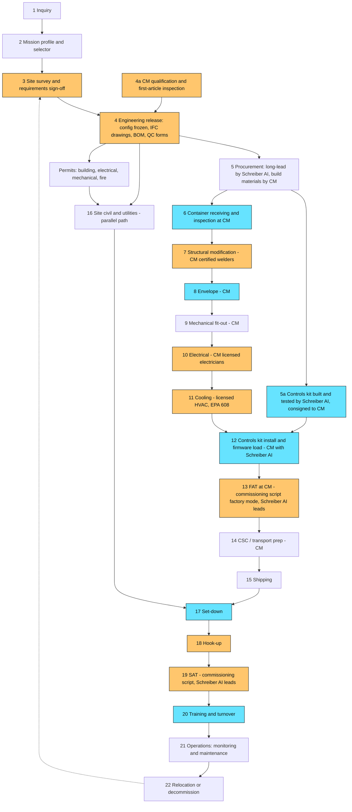
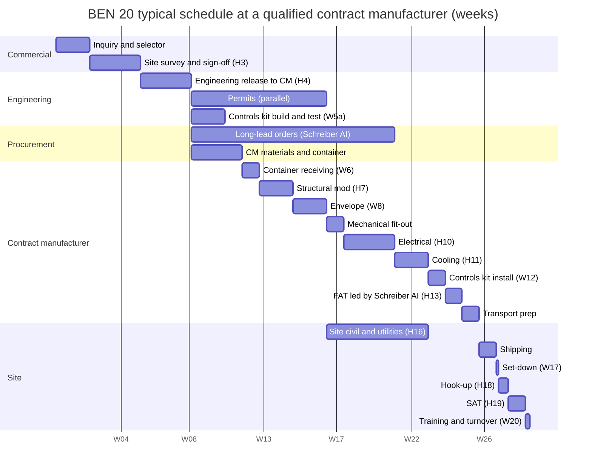

# BEN Engine — Manufacturing Process Flow (design to in service)

**Owner:** Schreiber AI operations. **Applies to:** BEN Micro, BEN 10, BEN 20, BEN 40. **Manufacturing model (operator decision, 2026-11-08):** **third parties first.** The build stages are performed by a **qualified contract manufacturer / integrator (CM)** — a container modification shop or modular electrical skid builder with licensed trades and, ideally, its own UL 508A panel shop — working from Schreiber AI's engineering release, with Schreiber AI's **controls kit**, QC forms and commissioning script, and with Schreiber AI engineers present at witness points and at FAT. A Schreiber AI greenfield factory is a later phase (see `docs/MANUFACTURING_STRATEGY.md`). **Rule:** every stage has an owner, inputs, outputs, hold points and records. A **hold point (H)** stops the work until a named person signs. A **witness point (W)** is an invitation: Schreiber AI quality, the customer or an inspector may attend; work continues if they decline in writing.

Owners: **ENG** Schreiber AI engineering (design authority) · **SAI-Q** Schreiber AI quality (witness, FAT, records) · **CM** contract manufacturer / integrator (build, its own QC, its licensed trades and certified welders, its UL 508A panel shop or a sub) · **SUB** certified subcontractor to the CM or to Schreiber AI (fire suppression contractor, EPA 608 refrigeration tech, PE, CWI, NRTL field evaluation) · **LOG** logistics · **SITE** site contractor (civil, crane, utility) · **CUST** customer · **AHJ** inspector / fire marshal / utility.

## 1. Flow

Amber = contains a hold point. Cyan = contains a witness point.

## 2. Stage table

"Schreiber AI quality presence" says who from Schreiber AI is physically or remotely present and what they do; everything else in that stage is the owner's work.

| # | Stage | Owner | Inputs | Outputs | Hold (H) / witness (W) points | Schreiber AI quality presence | Records produced | Typical duration | Exit criteria |
| --- | --- | --- | --- | --- | --- | --- | --- | --- | --- |
| 1 | **Inquiry** | Sales (Schreiber AI) or integrator partner | Customer need, budget range, location | Qualified opportunity; mission profile shortlist | — | — | CRM record | 1–2 weeks | Customer agrees to run the selector and a survey |
| 2 | **Mission profile & selector** | ENG + CUST | Profile, IT kW, racks, climate, redundancy, subsystems, white-label flag | `Config` JSON, derived sizing, budgetary price, **risk register shown before price** | — | — | Config v0.x, selector output PDF, risk acknowledgement | 1 week | Customer signs the risk acknowledgement and budgetary quote |
| 3 | **Site survey & requirements sign-off** | ENG (survey) + CUST | Site visit, utility letter, geotech if needed, flood map, noise ordinance, AHJ pre-application meeting | Signed `SITE_REQUIREMENTS.md`; AHJ position on building classification; utility fault current & voltage | **H3** customer signs site requirements; AHJ pre-app minutes received | ENG on site | Survey report, photos, utility letter, AHJ minutes | 2–4 weeks | H3 signed; no open "unknown" in the site form |
| 4a | **CM qualification & first-article inspection** (once per CM, repeated per new tier at that CM) | SAI-Q + ENG | RFI responses (`purchasing/email_queue/16-contract-manufacturer-rfi.md`), site audit, CM's certificates (UL 508A panel shop file, welder certs AWS D1.1, electrical licences, ISO 9001 if any), insurance | Approved CM on the Approved Supplier List for named tiers; **first article** (pilot unit) built under 100 % Schreiber AI witness and accepted; CM quality agreement signed | **H4a** CM approval; **H4a-FAI** first-article acceptance (every CTQ measured, every QC form Q-01..Q-12 completed, FAT passed) | SAI-Q audits the shop (2 days); ENG + SAI-Q present full time for the first article | Audit report, scorecard (`MANUFACTURING_STRATEGY.md` §4), quality agreement, FAI report | Audit 2–4 weeks; first article = one full build cycle | CM approved for tier; FAI report signed by both parties |
| 4 | **Engineering release** | ENG | Config, site data, compliance pack, CM's shop constraints (door sizes, crane, paint booth) | **Config frozen (v1.0)**; IFC drawing set with CTQ/CTP callouts; STE assembly instructions; BOM split into **Schreiber AI-supplied** (controls kit, long-lead equipment) and **CM-supplied** (container, steel, insulation, wire, consumables); QC forms Q-01..Q-12 pre-filled with unit serial; arc-flash & coordination study; PE anchorage calc; compliance pack; FAT/SAT procedure; **build package transmitted to CM** | **H4** engineering release review (ENG lead + compliance + SAI-Q); CM acknowledges the package (drawing receipt and buildability review) | ENG runs a 2-hour build-package review with the CM's project manager and shop lead | Release note, drawing index, BOM rev, calc packages, CM acknowledgement | 2–3 weeks | All drawings IFC; every CTQ has a check method; BOM 100 % sourced and split; permits applied for; CM has signed the package receipt |
| 5 | **Procurement** | Schreiber AI purchasing (long-lead and listed equipment: UPS, switchgear, cooling, CDU, batteries, fire system, racks); CM purchasing (container, structural steel, insulation, liner, doors, wire, raceway, fasteners, paint) | BOM split | POs; delivery schedule into the CM's dock; receiving inspection plan | — | SAI-Q reviews CM's material certs (steel, coating system) on receipt | POs, order acknowledgements, long-lead tracker, mill certs | Long-lead: UPS 8–16 wk, switchgear 10–20 wk, in-row/CDU 8–14 wk, transformer 10–16 wk, container 1–3 wk | All long-lead items confirmed with dates inside the schedule; CM materials on order |
| 5a | **Controls kit build and test** | ENG (Schreiber AI's own small shop or its UL 508A panel partner) | Controls panel drawings, nodes, gateway, switch, sensors, cables cut to length, labels | **Controls kit**: UL 508A-labelled controls panel, pre-addressed and calibrated nodes with `cal_id`, gateway imaged for this unit, sensor strings, labelled cable set, dP tubing, installation sheet; bench-tested end to end (every channel) before it ships | **W5a** kit bench test (CM may attend remotely) | ENG builds and tests; SAI-Q signs the kit test record | Kit test record (I/O 100 %), firmware hashes, calibration certificates, packing list; consignment note | 1–2 weeks (in parallel with 6–9) | Kit passes bench test; consigned to CM with serial numbers |
| 6 | **Container receiving & inspection** | CM | New one-trip high-cube container (CSC plated) or new cabinet (Micro) | Accepted container; baseline dimensions and squareness; CSC plate photographed | **W6** SAI-Q or customer may witness (remote photo review acceptable) | SAI-Q reviews Q-01 remotely within 24 h | Q-01 receiving report, photos, plate record, flatness/squareness (CTQ-S1) | 1 day | No dents > 20 mm, doors seal, floor sound, plate legible |
| 7 | **Structural modification** | CM (AWS D1.1 certified welders) under ENG drawing | IFC structural drawings, PE calc | Framed openings (doors, louvres, penetrations), reinforcing, floor stiffeners under UPS/battery, anchor clips | **H7** weld inspection (visual 100 %, MT 10 %) by CWI before closing in | SAI-Q witnesses the CWI inspection on first article and on every BEN 40; otherwise reviews the CWI report | Q-02 weld map, welder certs, CWI report, PE letter | 1–2 weeks | All welds accepted; squareness within CTQ-S1 after welding |
| 8 | **Envelope** | CM | Modified shell | Insulation (100 mm PIR / spray foam, R 3.5 m²K/W), vapour barrier, non-combustible liner, personnel doors with panic hardware, roof treatment, coating system per ISO 9223 class, door seals, drains | **W8** insulation and vapour barrier before liner (hidden work) | SAI-Q present or photo-witness before liner closes; approves coating DFT record | Q-03 envelope (coating DFT, insulation photos, door swing, blower-door) | 1–2 weeks | Liner closed only after W8 photos filed; leak test ≤ target (CTQ-E2) |
| 9 | **Mechanical fit-out** | CM | Racks, containment, cable tray, lighting, leak rope (from kit) | Racks anchored, hot-aisle containment, trays, lights, emergency lights, signage, drip trays | — | SAI-Q reviews Q-04 remotely | Q-04 rack anchor torque, layout check vs drawing | 1 week | Rack positions within ±5 mm; containment seals; aisle width ≥ drawing |
| 10 | **Electrical** | CM (licensed electrical contractor / its own licensed electricians) | Electrical IFC, BOM, wire sizing table (`BUILD_AND_WIRING.md`) | Main panel, UPS, PDUs, transformers, feeders, whips, grounding/bonding, SPDs, labels, arc-flash labels (provisional) | **H10a** rough-in inspection before covers; **H10b** torque and megger before energisation; **W10** customer or AHJ-of-record may witness | SAI-Q present for H10b (first article: both H10a and H10b); ENG available for RFIs within 4 h | Q-05 torque log, Q-06 insulation resistance / bonding continuity / phase rotation, circuit directory, label photos | 2–3 weeks | Energised from shop supply; phase rotation checked; no open items |
| 11 | **Cooling** | CM's licensed HVAC trade or SUB (EPA 608 technicians) | Mechanical IFC, refrigerant charge vs volume calc, **A1 refrigerant spec (R-513A/R-515B)** | In-row/cabinet DX or RDHx/CDU + dry cooler piping, condensate, refrigerant detector, glycol fill, pressure test | **H11** pressure test (nitrogen, 1.1× design, 24 h) and evacuation (≤ 500 µm hold) witnessed before charging | SAI-Q witnesses H11 on first article and spot-checks thereafter; reviews Q-07 | Q-07 pressure/evacuation chart, charge weight per circuit, glycol % and pH, refrigerant nameplate record | 1–2 weeks | Units run, superheat/subcool in range, no leaks at 24 h sniff |
| 12 | **Controls kit install & firmware load** | CM installs (mechanical mounting, cable pulls per STE sheet); ENG commissions | Controls kit (5a), network plan | Panel installed and labelled; nodes mounted at the sensor placement rules; MQTT topics visible; Modbus/SNMP maps for UPS/cooling/meters working | **W12** I/O point-to-point check (every channel) | ENG on site or remote-guided for the point-to-point; SAI-Q signs Q-08 | Q-08 I/O checklist (every `PROTOCOL.md` channel), firmware hashes, network diagram | 3–5 days | 100 % channels read correctly; failsafe outputs proven; no open alarms |
| 13 | **Factory acceptance test (FAT) at the CM** | **ENG leads**; CM provides load banks, shop power, labour; CUST witness | Full unit, commissioning script in **factory mode** | Signed FAT report; E1, E2, E3 (reduced), E4, E9, E11 (24 h), E12; agent system acceptance (fire contractor); door fan test | **H13** FAT sign-off by ENG, SAI-Q, CM and CUST (or waiver) | ENG + SAI-Q present full time (2–3 days plus burn-in remote watch) | Q-09 FAT summary; commissioning report (signed JSON + PDF), sweep CSVs, thermography, door fan test | 1 week incl. 24 h burn-in | All pass criteria met or deviations accepted in writing; CM punch list closed |
| 14 | **CSC / transport prep** | CM + LOG | FAT-passed unit | Racks blocked and strapped, UPS/battery shipping brackets, refrigerant isolated, glycol to safe level (cold routes), doors sealed, shock loggers fitted, weight ticket, transport mode decision | — | SAI-Q reviews Q-10 photos before release | Q-10 shipping checklist, packing list, weigh ticket, logger IDs, CSC decision | 2–3 days | Shipping checklist complete; permits for over-dimension if needed |
| 15 | **Shipping** | LOG | Prepared unit | Unit at site | — | — | Bill of lading, route permits, insurance certificate | 1–10 days domestic; 4–8 weeks export | Arrived, loggers read, no damage |
| 16 | **Site civil & utilities (parallel)** | SITE under CUST (or Schreiber AI turnkey) | Signed site requirements, PE pad & anchorage drawings, permits | Pad cured, anchors surveyed, grounding electrode tested, utility feeder and disconnect installed, fiber conduit, water/drain, fuel tank pad, fence, lights | **H16** pad survey and ground resistance test before set-down is scheduled | ENG reviews survey and ground test | Pad survey, concrete tickets, ground test, utility inspection | 4–10 weeks (alongside 5–13) | H16 signed; utility ready-to-connect letter |
| 17 | **Set-down** | LOG + SITE crane | Unit on truck; pad ready | Unit on anchors, level, bolted/welded, bracing removed | **W17** lift plan reviewed; customer may witness | SAI-Q or ENG on site | Q-11 set-down inspection, lift plan, anchor torque, level readings | 1 day | Anchors complete; doors operate; no transport damage |
| 18 | **Hook-up** | Licensed electrician + HVAC (CM's field crew, Schreiber AI's sub, or customer's contractor per contract) + SITE | Set unit, utilities ready | Feeder terminated, ground bonded, fiber spliced, water/drain/fuel connected, generator cabled, refrigerant/glycol recommissioned | **H18** pre-energisation check: phase rotation, torque, megger, ground continuity, utility inspection | ENG present for H18 | Hook-up checklist, AHJ electrical inspection sign-off | 2–5 days | AHJ releases power; unit energised on utility |
| 19 | **Site acceptance test (SAT)** | **ENG leads**; CUST; AHJ fire for suppression | Energised unit, commissioning script in **site mode** | Signed SAT report; E1, E2, E4, E5, E6, E9, E10, E12; fire alarm/suppression acceptance; arc-flash labels finalised | **H19** SAT sign-off; fire marshal acceptance | ENG + SAI-Q present | Q-12 SAT summary; commissioning report (site), acoustic survey, final labels, AHJ certificates | 3–5 days | All pass; certificates in hand |
| 20 | **Training & turnover** | ENG + CUST | Turnover package (`TURNOVER.md`) | Trained operators; passwords handed over; warranty registered; monitoring live | **W20** turnover meeting | ENG + operations | Training sign-off, turnover checklist, password handover record | 1–2 days | Checklist 100 %; customer accepts |
| 21 | **Operations** | Schreiber AI remote (managed) + local tech + certified subs; CUST for IT | Live unit | Alarms handled, maintenance per `MAINTENANCE.md`, calibration, patches, reports | — | Operations centre | Maintenance records, calibration certs, incident reports, monthly report | Life of unit | Continuous |
| 22 | **Relocation / decommission** | ENG + LOG + SUB (or CM field crew) | End of term or move | Refrigerant recovered, glycol drained, batteries removed/packed, data wiped (NIST 800-88), unit prepared as in 14, new site enters stage 3 | **H22** data sanitisation certificate and hazmat removal before transport | ENG | Decommission report, recovery records, battery shipping papers, sanitisation certificate | 1–2 weeks | Unit shipped or recycled; records archived |

### QC forms supplied to the CM (Q-01..Q-12)

| Form | Stage | Content (summary) |
| --- | --- | --- |
| Q-01 | 6 | Container receiving: dimensions, squareness, dents, floor, doors, CSC plate photo |
| Q-02 | 7 | Weld map, welder IDs and certs, CWI visual/MT results, squareness after welding |
| Q-03 | 8 | Insulation thickness and photos before liner, vapour barrier continuity, coating DFT grid, door swing/seal, leak test |
| Q-04 | 9 | Rack positions vs drawing, anchor torque, containment seal check, lighting lux |
| Q-05 | 10 | Torque log, 100 % of terminations, torque-seal marks |
| Q-06 | 10 | Insulation resistance per circuit, bonding continuity, phase rotation, label photos, circuit directory |
| Q-07 | 11 | Pressure test chart, evacuation log, charge per circuit (type, GWP, kg), glycol %, pH, superheat/subcool |
| Q-08 | 12 | I/O point-to-point: every channel in `PROTOCOL.md`, firmware hashes, `cal_id`, failsafe test |
| Q-09 | 13 | FAT summary: experiments run, pass/fail, deviations, signatures |
| Q-10 | 14 | Shipping prep: blocking/strapping, brackets, fluids, loggers, weight ticket, photos |
| Q-11 | 17 | Set-down: transport damage, anchors, level, logger readout |
| Q-12 | 19 | SAT summary and AHJ certificates |

Forms are issued pre-filled with the unit serial and the CTQ tolerances for that configuration; completed forms are returned as PDF plus the CSV data; Schreiber AI quality countersigns each before the next hold point is released.

## 3. Typical BEN 20 schedule (weeks from order) — at a qualified CM

Assumes the CM is already qualified (stage 4a done), long-lead items of 12 weeks (UPS and in-row units) and a permit cycle of 8 weeks. The critical path is procurement → fit-out → FAT. Site civil runs in parallel and must finish before shipping. The controls kit is built in parallel with the shell work.

Reading the chart: order to engineering release ≈ 8 weeks; release to FAT complete ≈ 16 weeks (set by the 12-week long-lead items, not by the CM); shipping, set-down, hook-up, SAT and turnover ≈ 3 weeks. **Order to in service ≈ 27 weeks for a BEN 20 at a qualified CM.** Add **one full build cycle (≈ 16 weeks) plus a 2–4 week audit** the first time a tier is built at a new CM (stage 4a first article). BEN Micro: ≈ 10–12 weeks. BEN 10: ≈ 20 weeks. BEN 40: ≈ 32–36 weeks.

## 4. Hold-point summary (the signatures that gate the money)

| Hold | Stage | Who signs | What they are saying |
| --- | --- | --- | --- |
| H3 | Site requirements | Customer + Schreiber AI ENG | "This is the site, these are the utilities, these are the permits and who pulls them." |
| H4a | CM qualification / first article | Schreiber AI quality + ENG + CM | "This shop, with these certificates and this first unit, can build this tier to our package." |
| H4 | Engineering release | ENG lead, compliance, SAI-Q; CM acknowledges | "Configuration is frozen; drawings, BOM, QC forms and calcs are complete; the CM has them." |
| H7 | Structural welds | CWI + ENG | "Modified container is structurally sound per PE calc." |
| H10a/b | Electrical rough-in / pre-energise | CM's licensed electrician + SAI-Q | "Wiring matches drawings; insulation and bonding tests pass." |
| H11 | Refrigerant / fluid pressure test | SAI-Q + HVAC trade | "No leaks; evacuated; correct charge and fluid." |
| H13 | FAT | ENG + SAI-Q + CM + customer | "The unit does what the commissioning script says, in the CM's shop." |
| H16 | Pad and utilities | Site contractor + ENG | "Pad, anchors, ground and utility are ready for this exact unit." |
| H18 | Pre-energisation at site | Licensed electrician + AHJ | "Safe to energise." |
| H19 | SAT | ENG + customer + fire marshal | "The unit does what the commissioning script says, on this site, and the fire systems are accepted." |
| H22 | Decommission | ENG + customer | "Data destroyed, hazards removed, safe to move." |

CM progress payments are tied to H7, H10b, H13 and shipment release (Q-10); Schreiber AI's own milestones with the customer are H4, H13, H19 and H3-turnover (see `MANUFACTURING_STRATEGY.md` §7).
