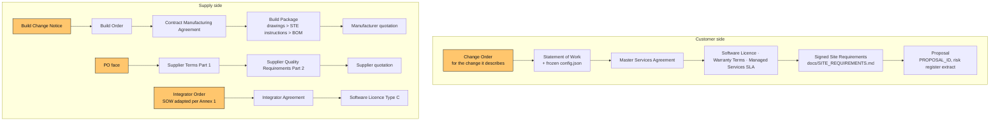

# BEN Engine — Contracts and Paperwork Index

> **TEMPLATE SET — not legal advice — have counsel review before use.**
> Schreiber AI · BEN Engine (Business Edge Node) · `docs/contracts/README.md` · Template rev [TEMPLATE_REV]

This folder holds the commercial paperwork for BEN Engine as a **two-sided system**: the customer side (Proposal → MSA → SOW → Change Orders → Acceptance → Warranty / Licence / SLA) and the supply side (Integrators, Contract Manufacturers, Suppliers). The two sides are written back-to-back so that delay, scope-change and quality risk land on the party that caused them. Every template is machine-fillable: bracketed `[FIELD_NAME]` tokens use one vocabulary listed in `docs/contracts/fields.json`, so the proposal generator can pre-fill a whole deal from the selector's `config.json` and the Proposal.

## 1. Documents

| # | File | What it is | Who signs | Side |
| --- | --- | --- | --- | --- |
| 1 | `MSA.md` | Master Services Agreement: the standing terms for every Unit a Customer buys | Schreiber AI, Customer | Customer |
| 2 | `SOW_TEMPLATE.md` | Statement of Work per Unit: configuration, scope by module, schedule, hold/witness points, acceptance table (10 commissioning steps), pricing, Change Order log | Schreiber AI, Customer | Customer |
| 3 | `CHANGE_ORDER.md` | Change Order form: price impact, schedule impact, re-baselined dates, delay classification | Both (PMs up to authority limit) | Customer (also used with Integrators) |
| 4 | `ACCEPTANCE_CERTIFICATES.md` | FAT, SAT and Turnover certificates with report and CSV SHA-256, QC forms, Punch List, financial close-out | Schreiber AI ENG, Factory/CM QC, Customer, AHJ acknowledgement | Customer |
| 5 | `SOFTWARE_LICENSE_BEN_CONTROLS.md` | Licence for BEN Pod firmware, BEN Controller (edge computer and PLC) image, dashboard: Type A perpetual per-Unit, Type B subscription (managed), Type C white-label; escrow; telemetry opt-in | Schreiber AI, Licensee (Customer or Integrator) | Customer / Integrator |
| 6 | `MANAGED_SERVICES_SLA.md` | Managed service: monitoring hours, alarm response by severity, maintenance per `docs/MAINTENANCE.md`, reporting, availability definition and exclusions, service credits, $/kW-month pricing | Schreiber AI, Customer | Customer |
| 7 | `WARRANTY_TERMS.md` | Warranty certificate: 12-month workmanship, module table, OEM pass-through, exclusions, what voids it, claim procedure, hose-test condition for H1–H3 envelopes, BEN Pod RMA | Issued by Schreiber AI | Customer |
| 8 | `NDA_MUTUAL.md` | Short mutual NDA for Stage 1 and for prospective partners | Both | Both |
| 9 | `INTEGRATOR_AGREEMENT.md` | Channel / white-label Integrator Agreement: appointment, certification, hold points they may not self-perform, QC forms Q-01…Q-12, discount schedule, branding, licence pass-through, support tiers, warranty flow, back-to-back LDs | Schreiber AI, Integrator | Supply |
| 10 | `CONTRACT_MANUFACTURING_AGREEMENT.md` | Build-shop agreement: build to IFC drawings and STE instructions, consigned vs purchased materials, quality plan with hold points and PPAP-lite, FAT at their facility, NCR and rework, LDs, IP, tooling, licensed trades, UL 508A, exit assistance, price per Unit by tier | Schreiber AI, Manufacturer | Supply |
| 11 | `SUPPLIER_TERMS.md` | PO Terms and Conditions plus Supplier Quality Requirements appendix: 90-day price hold, tariff pass-through rules, allocation, LDs, cover, warranty pass-through, CoCs, UL listings, register maps and STEP files, EPA 608, UL 9540/9540A, RoHS/REACH | Referenced on every PO | Supply |
| 12 | `fields.json` | Machine-readable list of every `[FIELD]`: name, description, type, default, and the documents that use it | — | Tooling |

## 2. Which document is used at which process stage

Stages are those of `docs/PROCESS_FLOW.md`. Hold points (H) gate the money; witness points (W) are invitations.

| Stage | Name | Customer-side paperwork | Supply-side paperwork |
| --- | --- | --- | --- |
| 1 | Inquiry | `NDA_MUTUAL.md` signed before any drawing, BOM price or firmware detail is shared | `NDA_MUTUAL.md` with prospective Integrators, Manufacturers, Suppliers |
| 2 | Mission profile and selector | Proposal `[PROPOSAL_ID]` generated from the selector with the Risk Register shown **before** the price; risk acknowledgement signed; `MSA.md` negotiated and signed (once per Customer) | Integrator registers the deal (`INTEGRATOR_AGREEMENT.md` 3.7) |
| 3 | Site survey and sign-off (**H3**) | `docs/SITE_REQUIREMENTS.md` completed and signed; becomes SOW Annex A | — |
| — | Order | `SOW_TEMPLATE.md` signed with `config.json`, schedule, price; Software Licence order form (Annex F); `MANAGED_SERVICES_SLA.md` (Annex E) if managed; milestone 1 (30 %) invoiced | Build Order issued under `CONTRACT_MANUFACTURING_AGREEMENT.md` Annex A; long-lead POs under `SUPPLIER_TERMS.md` |
| 4 | Engineering release (**H4**) | Configuration frozen; from here every change is a `CHANGE_ORDER.md`; milestone 2 (40 %) invoiced | Build Package issued to Manufacturer; BOM with purchased/consigned split; remaining POs |
| 5 | Procurement | — | POs with Delivery Dates, LDs, allocation clause; lead-time notifications flow in (`SUPPLIER_TERMS.md` 3.2) and out to the Customer as `CHANGE_ORDER.md` under MSA 6.6 / 17.2 where needed |
| 6–12 | Container receiving → controls (W6, H7, W8, H10a/b, W10, H11, W12) | Customer invited to witness points per SOW Section 6 | QC forms Q-01…Q-09 uploaded by Manufacturer or Integrator; NCRs dispositioned; Schreiber AI witness attendance |
| 13 | FAT (**H13**) | `ACCEPTANCE_CERTIFICATES.md` Part A signed; report and CSV SHA-256 recorded; milestone 3 (25 %) invoiced; title passes on payment | Build Order delivery event; Manufacturer milestone 4; LDs computed if late |
| 14–15 | Transport prep and shipping | Storage fees start if Customer site not ready (MSA 7.8) | Q-11; EXW Facility loading; Manufacturer storage fee passes through |
| 16 | Site civil and utilities (**H16**) | Customer-owned; late H16 = Customer-Caused Delay; LD exposure suspended | Integrator-owned under Install Partner model |
| 17–18 | Set-down, hook-up (W17, **H18**) | Q-12; AHJ power release | Licensed trades per `INTEGRATOR_AGREEMENT.md` 4.3 |
| 19 | SAT (**H19**) | `ACCEPTANCE_CERTIFICATES.md` Part B signed; warranty clock and SLA start | Integrator SAT always countersigned by Schreiber AI |
| 20 | Training and turnover (W20) | `ACCEPTANCE_CERTIFICATES.md` Part C; `WARRANTY_TERMS.md` certificate issued (Turnover E2); credential handover; milestone 4 (5 %) less LD credits and holdback | — |
| 21 | Operations | `MANAGED_SERVICES_SLA.md` monthly report and credits; `WARRANTY_TERMS.md` claims and RMA; Software Licence updates | Supplier warranty pass-through claims; epidemic failure; SCARs |
| 22 | Relocation / decommission (**H22**) | Relocation quoted as a new SOW; warranty continues only if Schreiber AI relocates (`WARRANTY_TERMS.md` 5.4) | — |

## 3. Order of precedence

Reading the diagram: higher boxes override lower ones. A SOW overrides the MSA only where it names the MSA section it overrides (MSA 2.2). Repository documents referenced by path apply in the revision the SOW states (SOW 2.3). Purchase orders, portals, invoices and acknowledgements add nothing (MSA 2.4, Supplier Terms 1.2).

## 4. Delay and LD flow-down matrix

The matrix states who owes whom what for each cause of delay, and which clause carries it. Rates are fields so that one deal can be tuned; the standard values are 0.5 % per week and a 10 % cap on every side, so that what Schreiber AI owes downstream is recoverable upstream on the same basis. Note for counsel: the **base differs** by tier of the chain (Unit price vs Build Order price vs PO line value), so recovery is back-to-back in rate but not necessarily in amount; Schreiber AI's exposure to the Customer is on the whole Unit price while a single late UPS PO yields LDs only on that PO line. The grace day fields (`LD_GRACE_DAYS`, `CM_LD_GRACE_DAYS`, `SUPPLIER_LD_GRACE_DAYS`) should be set so that the supplier grace is **shorter** than the customer grace.

| Cause of delay | Who owes | To whom | What | Clause | What else happens |
| --- | --- | --- | --- | --- | --- |
| **Supplier late** (component later than PO Delivery Date, not excused) | Supplier | Schreiber AI (or Manufacturer as Buyer) | LDs `[SUPPLIER_LD_RATE_PCT_PER_WEEK]` % of the late PO line value per week after `[SUPPLIER_LD_GRACE_DAYS]` days, cap `[SUPPLIER_LD_CAP_PCT]` %; expedite costs at Supplier's cost; cover difference if > `[SUPPLIER_COVER_TRIGGER_WEEKS]` weeks | `SUPPLIER_TERMS.md` 3.4–3.6 | Supplier must notify lead-time change within 2 Business Days (3.2) and allocate pro-rata (3.3); Schreiber AI passes allocation notice to Customer within 10 Business Days (MSA 6.6, 17.2) |
| **Contract Manufacturer late** (FAT Acceptance later than Delivery Date, not excused) | Manufacturer | Schreiber AI | LDs `[CM_LD_RATE_PCT_PER_WEEK]` % of Build Order price per week after `[CM_LD_GRACE_DAYS]` days, cap `[CM_LD_CAP_PCT]` %; expediting at Manufacturer's cost; removal and completion elsewhere with excess cost charged if > `[CM_COVER_TRIGGER_WEEKS]` weeks | `CONTRACT_MANUFACTURING_AGREEMENT.md` 9.4–9.6 | Set-off against milestone 4; Manufacturer excused only for late consigned materials, late Build Package, Schreiber AI changes, or supplier allocation where it ordered promptly and notified within 2 Business Days (9.3, 15.1) |
| **Schreiber AI late to Customer** (FAT later than baseline, not excusable) | Schreiber AI | Customer | LDs `[CUSTOMER_LD_RATE_PCT_PER_WEEK]` % of Unit price per week after `[LD_GRACE_DAYS]` days, cap `[CUSTOMER_LD_CAP_PCT]` %, **sole remedy** for delay; Customer may terminate the SOW if the cap is reached and FAT not passed within `[LD_CAP_CURE_DAYS]` more days | `MSA.md` 7.7, 18.3; `SOW_TEMPLATE.md` 7.3 | Credited against milestone 4 on the Turnover Certificate C.7; counts toward the liability cap (MSA 11.4); recovered upstream through the two rows above |
| **Schreiber AI late to Integrator** (Resale / Install Partner Units; engineering package or Controls Kit for Licensed Builder) | Schreiber AI | Integrator | LDs `[LD_RATE_PCT_PER_WEEK]` % per week after `[LD_GRACE_DAYS]` days, cap `[LD_CAP_PCT]` %, sole remedy | `INTEGRATOR_AGREEMENT.md` 13.1 | Integrator may not promise its End Customer more than this for Schreiber AI's scope without bearing the difference (13.2) |
| **Customer site late** (H3, H16, permits, utility, fiber, access, decisions, payment) | Customer | Schreiber AI | Every later baseline date moves day for day plus re-sequencing; **Schreiber AI's LD exposure is suspended**; milestones invoiced on baseline dates; storage `[STORAGE_FEE_PER_DAY]` per day after `[FREE_STORAGE_DAYS]` free days; crane re-mobilisation `[CRANE_REMOB_FEE]` if < `[CRANE_NOTICE_DAYS]` Business Days' notice; standby `[STANDBY_RATE_PER_DAY]` per person-day; re-commissioning `[RECOMMISSIONING_FEE]`; re-engineering for changed utility data; OEM storage and warranty-start charges at cost | `MSA.md` 5.5, 7.5, 7.8, 9.3; `SOW_TEMPLATE.md` 5.2, 7.4 | Manufacturer's facility storage after `[CM_FREE_STORAGE_DAYS]` free days at `[CM_STORAGE_FEE_PER_DAY]` passes through (CMA 9.8); OEM warranty shortfall from storage is Customer's (`WARRANTY_TERMS.md` 3.5) |
| **Integrator-owned site late** (Install Partner / Licensed Builder) | Integrator | Schreiber AI | Same as the Customer row: LD suspension, baseline-date invoicing, storage, crane, standby, re-commissioning | `INTEGRATOR_AGREEMENT.md` 13.3 | Integrator recovers from its End Customer through the MSA 7.5/7.8 equivalents it must include (6.2, 13.2) |
| **Customer scope change** (any change after H4 to configuration, site values, delivery model, scope, document revision) | Customer | Schreiber AI | Change Order with price impact (re-engineering, OEM cancellation/restocking, re-procurement, rework, repeated tests, permit re-submission) and schedule impact in days; **re-baselined FAT, shipment, SAT and Turnover dates**; new Unit price becomes the LD base; LD exposure suspended for the schedule delta | `MSA.md` 6.1–6.4; `CHANGE_ORDER.md` 3, 4; `SOW_TEMPLATE.md` 11 | Schreiber AI issues BCN to Manufacturer (CMA 12) and PO changes to Suppliers (Supplier Terms 8); their costs flow into the Change Order price |
| **AHJ requirement beyond the compliance pack** (classification, field evaluation, sprinklers) | Shared: Customer pays the work by Change Order; neither owes LDs for the excusable period | — | Change Order; dates re-baselined; no LDs or delay charges for the excusable period | `MSA.md` 6.1, 7.6, 20.2; Risk R15 | Field evaluation can be pre-priced as a SOW option (SOW 3.7) |
| **Force majeure / supply allocation / tariff / discontinuance / listing change** | Nobody owes LDs | — | Dates move by the FM period plus remobilisation; Change Order for documented cost difference (tariff, alternate); approved alternates used; either side may terminate the SOW after `[FM_TERMINATION_DAYS]` days with payment for work done | `MSA.md` 6.6, 17.1–17.4; `CMA` 15; `SUPPLIER_TERMS.md` 2.3, 3.3, 12 | Allocation counts as FM for Supplier/Manufacturer **only** if they ordered promptly, notified within 2 Business Days and pursued the alternate; tariff pass-through is documented incremental duty only, no markup |
| **Schreiber AI-caused Change Order** (drawing error, consigned material defect) | Schreiber AI | Customer / Manufacturer | No price impact to Customer; LD reference date does not move; Manufacturer's Delivery Date moves day for day and its rework is paid by Schreiber AI | `CHANGE_ORDER.md` 4; `CMA` 7.3, 9.3 | |
| **Transport damage** | Schreiber AI repairs before SAT; pursues carrier and transit insurer | Customer | Repair or replacement at no cost where Schreiber AI arranged transport | `MSA.md` 7.10 | Shock loggers on every Unit (Q-11) |
| **Nonconformance at FAT** | Party that caused it | — | Manufacturer: rework and re-test at its cost incl. Schreiber AI re-attendance; Schreiber AI cause: Schreiber AI's cost; OEM defect: OEM warranty; Customer-side cause at SAT: re-commissioning fee | `CMA` 6.3, 7.3; `MSA.md` 8.6, 7.8(d) | After `[MAX_RETEST_ROUNDS]` failed rounds the Customer may demand a corrective plan and terminate if missed (MSA 8.6) |

## 5. Paperwork checklist per deal

### 5.1 Customer deal (one Unit)

| Step | Document | Pre-filled from | Signed by | Stage |
| --- | --- | --- | --- | --- |
| 1 | `NDA_MUTUAL.md` | CRM | Both | 1 |
| 2 | Proposal with risk register extract and risk acknowledgement | Selector (`config.json`), `docs/RISK_REGISTER.md` | Customer | 2 |
| 3 | `MSA.md` (once per Customer) | fields.json entity block | Both | 2 |
| 4 | `docs/SITE_REQUIREMENTS.md` (SOW Annex A); for BEN 2000 also the building-permit pre-application, utility MV service application and plant-yard plan | Site survey | Customer, Customer's electrician, Schreiber AI ENG and Compliance | 3 (H3) |
| 5 | `SOW_TEMPLATE.md` with Annexes B–H (tier, `[HARDENING_LEVEL]` H1/H2/H3 and the hardening test rows in the acceptance table) | Proposal, `config.json`, price table, schedule from `docs/PROCESS_FLOW.md` durations | Both | Order |
| 6 | `SOFTWARE_LICENSE_BEN_CONTROLS.md` order form (SOW Annex F) | Delivery model | Both | Order |
| 7 | `MANAGED_SERVICES_SLA.md` (SOW Annex E) if managed | IT kW, profile, climate | Both | Order |
| 8 | Remote support consent form (SOW Annex G); regulated-data addendum (Annex H) if needed | Profile | Customer | Order / Turnover |
| 9 | `CHANGE_ORDER.md` for every change after H4 | SOW, config diff | PMs or signatories | 4 onward |
| 10 | `ACCEPTANCE_CERTIFICATES.md` Part A (FAT) | Commissioning Report (factory mode) | ENG, Factory/CM QC, Customer witness | 13 (H13) |
| 11 | `ACCEPTANCE_CERTIFICATES.md` Part B (SAT) | Commissioning Report (site mode), AHJ certificates | ENG, Customer, fire marshal acknowledgement | 19 (H19) |
| 12 | `ACCEPTANCE_CERTIFICATES.md` Part C (Turnover) and `WARRANTY_TERMS.md` certificate | `docs/TURNOVER.md` checklist, OEM registrations | ENG, Customer | 20 (W20) |
| 13 | Credential handover record (`docs/TURNOVER.md` Section 3) | — | ENG, Customer | 20 |
| 14 | Monthly SLA reports; warranty claims; RMAs; hose test repeated every 3 years and after relocation (all hardening levels), shield integrity test annually at H3 | Edge computer data, maintenance records | — | 21 |

### 5.2 Integrator onboarding

| Step | Document | Notes |
| --- | --- | --- |
| 1 | `NDA_MUTUAL.md` | Before sharing drawings, STE instructions, pricing or discount schedule |
| 2 | Qualification: licences, insurance certificates, references, Territory and Delivery Models | `INTEGRATOR_AGREEMENT.md` 1.7, 11 |
| 3 | `INTEGRATOR_AGREEMENT.md` with Annex 1 (SOW changes) and Annex 2 (rates) | Discount tier set from committed volume (3.2); exclusivity only with minimum commitment (2.4) |
| 4 | `SOFTWARE_LICENSE_BEN_CONTROLS.md` Type C master, with Brand File approval (8.3) and remote endpoint election (7.3) | Full source licence and own signing key optional (7.4) |
| 5 | Certification roster: sales engineer, PM, 2 field technicians, commissioning lead, L1 support engineer | Section 4.1; certificates with expiry in the portal |
| 6 | First Integrator Order; Schreiber AI witnesses all hold points of the first `[FIRST_UNITS_MANDATORY_WITNESS]` Units per Tier and every BEN 500 and BEN 2000 | Section 5.2 |
| 7 | Integrator's End Customer contract template reviewed for the mandatory flow-down provisions | Section 6.2 |
| 8 | Marketing materials and Brand File approved | Sections 8, 14 |

### 5.3 Supplier onboarding

| Step | Document | Notes |
| --- | --- | --- |
| 1 | `NDA_MUTUAL.md` where volumes, configurations or customer identities will be shared | Optional for catalog distributors |
| 2 | Supplier quality questionnaire and Part 2 category requirements for the Supplier's categories | `SUPPLIER_TERMS.md` Q1 |
| 3 | Quotation with 90-day price hold, country of origin, listing evidence, lead time, cancellation charges disclosed, STEP files and register maps | Sections 2.2, 2.3(e), 8.2, Q2 |
| 4 | First-article approval for new part numbers / manufacturers / revisions | Q3.7 |
| 5 | PO referencing `SUPPLIER_TERMS.md` rev, Delivery Date, LD rate and cap, required documents | Q4 PO face |
| 6 | Insurance certificate; SDS; RoHS/REACH declarations; UL 9540A report for batteries; AIM Act statement for cooling; UL 752, ASTM F3038 and IEEE 299 / MIL-STD-188-125-1 certificates for H2/H3 hardening lines | Sections 11, Q3 |
| 7 | Quarterly performance review; SCARs | Q3.8, Q3.10 |

### 5.4 Contract manufacturer onboarding

| Step | Document | Notes |
| --- | --- | --- |
| 1 | `NDA_MUTUAL.md` | Before the Build Package is shown |
| 2 | Qualification audit of the Facility (container shops for BEN 30/150/500; prefabricated modular-building manufacturers for BEN 2000, `docs/MANUFACTURING_STRATEGY.md` §3.2): WPS/PQR and welder certs, CWI, electrical and HVAC licences, EPA 608 certificates, fire contractor, UL 508A status, calibrated gauges, lifting equipment, shop power and load banks, quality system, insurance | `CONTRACT_MANUFACTURING_AGREEMENT.md` 3.1, 8, 13 |
| 3 | `CONTRACT_MANUFACTURING_AGREEMENT.md` with Annex B (consigned), Annex C (tooling), Annex D (rates) and price per Unit by tier (11.1) | LD rate and cap set back-to-back with the MSA (9.4, 9.7) |
| 4 | Build Package release per Tier: drawings, STE instructions, QC forms, BOM with purchased/consigned split, wiring and torque tables, PE calc, FAT procedure | Section 1.2 |
| 5 | First Build Order (Annex A) = First Article with full PPAP-lite documentation and Schreiber AI attendance at every hold and witness point | Section 3.2, 3.3 |
| 6 | Supplier POs for Purchased Materials placed under `SUPPLIER_TERMS.md` or equivalent within `[PO_PLACEMENT_DAYS]` Business Days | Section 4.2, 9.3 |
| 7 | Weekly progress reports; QC forms uploaded within 2 Business Days; NCRs dispositioned by Schreiber AI | Sections 5.4, 7, 9.2 |
| 8 | FAT Certificate Part A co-signed; Q-11; EXW loading | Sections 6.4, 9.9 |

## 6. Field vocabulary

The complete list is `docs/contracts/fields.json` (one entry per field: `name`, `description`, `type`, `default`, `source`, `documents`). The proposal generator fills a deal by substituting every `[FIELD_NAME]` token in the chosen templates; a token left unfilled must be visible in review, so templates never ship with brackets. Field name conventions:

| Prefix / pattern | Meaning | Examples |
| --- | --- | --- |
| `SCHREIBER_*`, `CUSTOMER_*`, `INTEGRATOR_*`, `CM_*`, `SUPPLIER_*`, `COUNTERPARTY_*`, `LICENSEE_*` | Party identity, signatories, notices | `SCHREIBER_ENTITY_NAME`, `CUSTOMER_SIGNATORY_TITLE`, `CM_FACILITY_ADDRESS` |
| `*_ID` | Document identifiers | `MSA_ID`, `SOW_ID`, `PROPOSAL_ID`, `CONFIG_ID`, `CO_NUMBER`, `PO_NUMBER`, `BUILD_ORDER_ID`, `FAT_CERT_ID`, `SAT_CERT_ID`, `TURNOVER_CERT_ID`, `WARRANTY_CERT_ID`, `LICENSE_ID`, `SLA_ID`, `NDA_ID` |
| Configuration fields (match `spec/ben-config.schema.json`) | Copied from `config.json` | `TIER`, `HARDENING_LEVEL`, `PROFILE`, `IT_KW`, `RACKS`, `COOLING`, `REDUNDANCY`, `CLIMATE`, `SUBSYSTEMS`, `WHITE_LABEL`, `BRAND_NAME`, `UPS_MINUTES`, `GENERATOR`, `SITE_NAME`, `CONFIG_JSON` |
| Derived sizing | From `config.derived()` | `ASHRAE_CLASS`, `ASHRAE_MAX_C`, `SERVICE_VOLTAGE`, `SERVICE_BREAKER_A`, `TOTAL_KVA`, `UPS_MODULES`, `UPS_KVA_EACH`, `BATTERY_KWH`, `NFPA855_PACKAGE`, `COOLING_UNITS_TOTAL`, `NODE_COUNT`, `PUE_ESTIMATE`, `GROSS_MASS_KG` |
| `PRICE_*`, `MILESTONE_*`, `CONTRACT_VALUE_TOTAL`, `CURRENCY` | Money | `PRICE_TOTAL`, `MILESTONE_1_PCT`, `MILESTONE_3_AMOUNT` |
| `DATE_*_BASELINE`, `DATE_*_CURRENT`, `CO_NEW_DATE_*` | Schedule | `DATE_FAT_BASELINE`, `DATE_SAT_CURRENT`, `CO_NEW_DATE_TURNOVER` |
| LD and delay fields | Two-sided delay economics | `CUSTOMER_LD_RATE_PCT_PER_WEEK`, `CUSTOMER_LD_CAP_PCT`, `LD_RATE_PCT_PER_WEEK`, `LD_CAP_PCT`, `LD_GRACE_DAYS`, `CM_LD_RATE_PCT_PER_WEEK`, `CM_LD_CAP_PCT`, `SUPPLIER_LD_RATE_PCT_PER_WEEK`, `SUPPLIER_LD_CAP_PCT`, `STORAGE_FEE_PER_DAY`, `FREE_STORAGE_DAYS`, `CRANE_REMOB_FEE`, `STANDBY_RATE_PER_DAY`, `RECOMMISSIONING_FEE` |
| `INSURANCE_*`, `*_INSURANCE_*` | Insurance limits | `INSURANCE_CGL_PER_OCCURRENCE`, `INSURANCE_CYBER`, `CM_INSURANCE_PROPERTY` |
| `FAT_*`, `SAT_*`, `TO_*`, `Q01_*`…`Q12_*` | Values filled from the Commissioning Report and QC forms | `FAT_CSV_SHA256`, `SAT_STEP8_MINUTES_TO_MAX`, `TO_CREDS_CHANGED`, `Q07_SIGNATORY` |
| `DOC_REV_*`, `TEMPLATE_REV` | Document revisions pinned in the SOW | `DOC_REV_PROCESS_FLOW`, `DOC_REV_QC_FORMS` |
| `GOVERNING_STATE`, `VENUE_COUNTY`, `ARBITRATION_BODY`, `ARBITRATION_CITY` | Legal venue | Set once per Customer; confirm with counsel |

Validation rule for the generator: after substitution, `grep -c '\[[A-Z][A-Z0-9_]*\]'` on the output must be 0 for a document to be marked "ready for signature".

## 7. Assumptions to confirm with counsel

1. Liquidated damages at 0.5 % per week with a 10 % cap, as sole remedy for delay, on every side of the chain; enforceability as a genuine pre-estimate varies by state.
2. Deemed acceptance after 10 Business Days and acceptance by production use (MSA 8.4).
3. Title retention with a purchase-money security interest until milestone 3 (MSA 7.3) and progressive title at the Manufacturer (CMA 10.1); UCC filings required.
4. Liability cap as a multiple of fees with carve-outs for indemnity, bodily injury, confidentiality/data breach (separate higher cap), IP, payment and fraud (MSA 11).
5. Mutual exclusion of consequential damages including Customer's lost workloads; whether cost of substitute cloud capacity should be recoverable up to a sub-cap.
6. Arbitration before a single arbitrator with a technical-expert step for acceptance and warranty disputes (MSA 19).
7. Warranty disclaimer of PUE, ride-through and availability except as measured at SAT or promised in the SLA.
8. Service credits as sole remedy for SLA misses; chronic-failure termination right.
9. Software licence: anti-reverse-engineering of signed images subject to mandatory interoperability exceptions; escrow release triggers including failure to patch a critical vulnerability.
10. Integrator non-circumvention and employee non-solicit durations; enforceability varies by state.
11. Contract Manufacturer non-compete on derived units (CMA 14.2) and the right to remove Units and tooling from the Facility on delay (CMA 9.6) — replevin mechanics.
12. Supplier tariff pass-through limited to documented incremental duty with no markup, and the 90-day price hold as a default when the quotation is silent.
13. Delivery term choice: DAP site for Customers, EXW Facility for the Manufacturer, DAP ship-to for Suppliers; confirm against Schreiber AI's freight insurance programme.
14. Export control statements (EAR) for units and firmware; whether a BAA template is needed for healthcare Managed Services.
15. Whether the Integrator's End Customer sublicence should be a Schreiber AI-form end-user licence rather than flow-down language.

---
Schreiber AI · BEN Engine (Business Edge Node) · Ben@SchreiberAI.com · Index maintained at `docs/contracts/README.md` · TEMPLATE SET — not legal advice — have counsel review before use.
